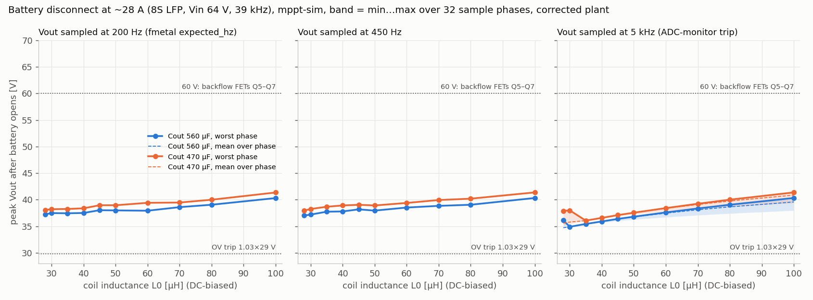

*this document is an LLM generated placeholder*

# Vout overshoot on battery disconnect vs coil inductance



Host closed-loop sim (`test/host-stub/mppt-sim.sh`, scenario `a`): the battery opens at ~28 A charge current. The
setup is 8S LFP (Vbat_max 29 V), PV at Vin ~64 V, 39 kHz, `reverse_current_paranoia=1` (OV trip at 29.9 V), and
there is no other load on the bus. The value plotted is the plant's per-PWM-cycle Vout peak within 1 s of the event.

- Sweep: Cout 470/560 µF × L0 28–100 µH × trip sample rate 200/450/5000 Hz × 32 sample phases
  (`SIM_PHASE_US` = k/32 of the sample period). Raw results: `sweep.txt`
  (`C L hz phase_us first_trip t_ms peak_V`; `t_ms` excludes the phase offset). All 1920 runs trip on Vout-OV.
- The firmware rejects L0 below ~26 µH (`pwmFreq*L0 > 1` after the 5 % DC-bias derate).
- 5 kHz stands in for an interrupt-driven ADC threshold-monitor trip. It does not model the monitor or the
  RC filter in front of the ADC pin.

## Findings

- The peak is set by the coil energy at the event: Vpk ≈ V0 + I·√(L/C) (35.4 V at 30 µH / 470 µF, 41.2 V at
  100 µH). Stopping the switches does not stop that energy reaching Cout, so no trip rate gets below it.
- A slower trip adds only what the controller delivers before it: at 200 Hz, +2.5 V at 28–30 µH and ~0 V at
  100 µH over the 5 kHz mean. Worst case over all cases is 41.4 V (100 µH, 470 µF).
- At 200 and 450 Hz the peak does not depend on the sample phase: it occurs within the first LC quarter period
  (0.2–0.37 ms), before the first sample. At 5 kHz a few phases trip one or two samples late (0.4–0.6 ms) and
  reach the 200 Hz value.

## Earlier result withdrawn

A first sweep (8 phases) showed 55–66 V at 200 Hz and small L, a knee near 45 µH and phase-dependent late trips.
That was a solver artifact: the per-cycle plant advanced the coil current with the cycle-start Vout, which is
forward Euler in the L–C_out loop and grows the ring once the battery is gone. `test/host-stub/overshoot-plant.cpp`
compares the plant against a fine-step reference at frozen duty. With a synchronous LS the old plant reached
60–62 V where the reference peaks at 35–43 V. `src/sim/vconv.cpp` now runs each cycle twice (midpoint Vout) and
matches the reference within 0.04 V. With the LS off (body diodes only) the converter really does pump Vout toward
Vin (58–64 V at frozen duty); in the closed-loop sim this does not happen before the trip.

Reproduce:

```bash
OUT=/tmp/mppt-sim-sweep test/host-stub/mppt-sim.sh sanity   # build
SIM_PHASE_US=0 SIM_ADC_HZ=200 SIM_CONF="coil.conf:L0=30e-6,vconv.conf:plant_c_out=470e-6" /tmp/mppt-sim-sweep a
doc/research/overshoot-vs-L/sweep.sh /tmp/mppt-sim-sweep /tmp/lsweep 32     # P=4 local; 4th arg: runner prefix
.venv/bin/python3 doc/research/overshoot-vs-L/plot.py /tmp/lsweep/results.txt overshoot-vs-L.png
clang++ -std=gnu++20 -O2 -I src test/host-stub/overshoot-plant.cpp src/sim/vconv.cpp -o /tmp/ovp && /tmp/ovp 30 470 sync
```
