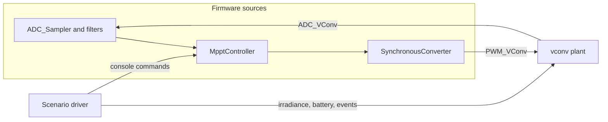

# Simulation

The control code can run against a software model of the power stage instead of real hardware. There are two ways
to do this, and both use the same plant model, vconv:

- A **vconv firmware build** runs the complete firmware on an ESP32, in real time, against the plant.
- The **host simulator** (`mppt-sim`) compiles the real-time control path for the host and runs it against the plant
  in simulated time, driven by scripted scenarios.

:::note PV emulator
The [PV emulator](../guide/operating-modes.md#pv-emulator) (`pv <isc> <voc>`) is an operating mode of a real
converter: its output follows a solar panel curve, so a second converter can track it on the bench. Older versions
of these pages call it the PV simulator.
:::

## Comparison

| | vconv build | Host simulator | [Wokwi](wokwi.md) |
|---|---|---|---|
| Runs on | Any ESP32-S3 or ESP32 board | Host (macOS, Linux) | Wokwi emulator |
| Plant | vconv | vconv, plus board presets and a multi-peak PV string | None (`adc=fake`) |
| Time | Real time | Simulated, faster than real time | Real time |
| Firmware | Complete image | Real-time control path and the low-frequency control work | Complete image |
| Driven by | Console, `set-config`, `vconv set` | Scenario name and `SIM_*` environment variables | Console |
| Suits | Interactive work, console and telemetry paths | Regression runs and what-if studies across scenarios | Boot and console smoke tests |

## Plant model

`src/sim/vconv.h` and `src/sim/vconv.cpp` model a synchronous buck or boost converter in plain C++, with no Arduino,
FreeRTOS or ESP-IDF dependency. The model steps once per switching cycle and tracks the coil current through each
phase of the cycle, so it covers CCM, DCM and reverse current.

It models these parts:

- A [PV source](#pv-source): a single panel, or a [string with bypass diodes](#pv-string) in the host simulator only
- Battery as a voltage behind a series resistance, with optional bus ripple (sine, rectified, spiky)
- Coil, input and output capacitors
- Gate timing at LEDC or MCPWM count resolution, dead time, body-diode drop, conduction and switching losses
- Switch-node ringing while both switches are off
- Backflow switch and fault injection (stuck switch, high-side short)
- Gaussian sensor noise, and a sun model with day, night and clouds

[`vconv.conf`](../reference/config/vconv.md) lists every parameter. The topology comes from `converter.conf::topo` and
the coil from `coil.conf::L0`.

### PV source

The PV source is an ideal single-diode cell: a photocurrent source in parallel with a diode, with no series or shunt
resistance.

```
     ┌──────────┬──────────○ +
     │          │
    (↑) Isc    ─▼─ D
     │          │
     └──────────┴──────────○ −
```

Its I-V curve is

$$
I(V) = I_{sc} - I_0 \left(e^{\alpha V / V_{oc}} - 1\right), \qquad I_0 = \frac{I_{sc}}{e^{\alpha} - 1}
$$

The shape factor α follows from the curve factor $k = V_{mpp}/V_{oc}$ through $\alpha (1 - k) = \ln(1 + k\alpha)$,
which places the maximum power point at exactly $k \cdot V_{oc}$. For $k = 0.8$, α is about 11.5. The model lives in
`src/math/pv_model.h`, which the [PV emulator](../guide/operating-modes.md#pv-emulator) also uses. The curve has
a single maximum.

### PV string

The host simulator can replace the single source with a string of 1 to 6 series substrings. Each substring is a PV
source as above, with its own irradiance factor $g_i$ on $I_{sc}$, its own share $w_i$ of $V_{oc}$, and a bypass
diode with forward drop $V_d$. A shaded substring gets bypassed once the string current exceeds its own short-circuit
current, so the P-V curve has up to one peak per substring.

```
   + ○──────┬─────────────────┐
            │                 │
       ┌────┴─────┐           │
       │g1·Isc ‖ D│          ─▲─  bypass
       │ w1·Voc   │           │   diode
       └────┬─────┘           │
            ├─────────────────┤
       ┌────┴─────┐           │
       │g2·Isc ‖ D│          ─▲─
       │ w2·Voc   │           │
       └────┬─────┘           │
            ├─────────────────┤
            ⋮                 ⋮
       ┌────┴─────┐           │
       │gn·Isc ‖ D│          ─▲─
       │ wn·Voc   │           │
       └────┬─────┘           │
   − ○──────┴─────────────────┘
```

Two variants compute the string current:

- **Fast** (default): the string current at a voltage is the best of "the m strongest substrings conduct, the rest
  are bypassed". The conducting substrings share the voltage by $w_i$.
- **Exact** (`SIM_PV_EXACT=1`, and the default for some weather scenarios): a tabulated series sum of the substring
  voltages $V(I)$. Each substring consists of two halves that can be shaded separately.

A vconv firmware build always runs the single source, since `vconv.conf` has no string keys.

## vconv firmware build

With `CONFIG_FUGU_WITH_VCONV=y`, `PWM_VConv` replaces the gate driver and `ADC_VConv` replaces the ADC. The tracker, PD
controllers, charger and protection run unchanged against the plant.
[Build options](../guide/getting-started/build-options.md#control-loop-work-without-hardware) gives the build commands.
Provision `config/lab/vconv_mock` (`vconv_mock_esp32` on a classic ESP32).

`set-config vconv.conf <key> <value>` followed by `restart` changes the plant. Some keys also change at runtime with
`vconv set <key> <value>`. [Agentic programming](agentic-programming.md#3-virtualconverter-vconv) describes a workflow
built on this build.

:::danger Never OTA a vconv build to a real converter
A vconv image never switches the half-bridge, so a converter running it stops converting.
:::

## Host simulator

`test/host-stub/mppt-sim.cpp` compiles these firmware sources for the host:

- `ADC_Sampler` and the sensor filters
- `MpptController`: protection, PD controllers, tracker and charger
- `SynchronousConverter` and the vconv ADC backend and PWM driver

The simulator replicates the RT loop (`loopRT`, `loopRTNewData`, `stopAndBackoff`) and the low-frequency control work
(`lfControl`, `lfWatchdog`, `lfStuckWatchdog`) from `main.cpp`. Stubs in `test/host-stub/esp/` stand in for ESP-IDF.



Each ADC tick advances the simulated clock (`esp_timer_get_time()`) and steps the plant. The tick rate defaults to
450 Hz (`SIM_ADC_HZ`), quantized to 1 µs as the hardware timer is.

The simulator copies `config/lab/vconv_mock/conf` to a temporary directory and reads it through a `/littlefs`
redirect. It switches `converter.conf` from `mode=psu` to MPPT, and each scenario appends its own keys to `vconv.conf`
and `limits.conf`.

### Running

The script builds `/tmp/mppt-sim` with `clang++` (C++20) and runs the given scenarios:

```bash
test/host-stub/mppt-sim.sh                    # build, run the default scenario list
test/host-stub/mppt-sim.sh sanity wx-cloud    # build, run two scenarios
/tmp/mppt-sim wx-shade2                       # run one scenario with the built binary
OUT=/tmp/sim-b test/host-stub/mppt-sim.sh     # build to another path
```

The script runs every scenario it is given and exits non-zero if any failed. The `cv-hold-*` scenarios run only when
named.

### Scenarios

The scenario name selects the setup, the events and the result lines. `mppt-sim.cpp` starts with a comment that
describes each scenario.

| Scenarios | Covers | Result line |
|---|---|---|
| `sanity` | 90 s of tracking at full power | |
| `a`, `b`, `c`, `e*` | Battery disconnect at full power, in low light (`b`), near the voltage limit (`c`); `e`: disconnect and reconnect | `== RECONNECT` (`e`) |
| `d-cloud`, `d-bus*`, `d-noise` | Cloud steps, bus voltage steps, sensor noise and bus ripple | |
| `*-p0` suffix | The same with `limits.conf::reverse_current_paranoia=0` | |
| `shade`, `shade-cv` | Half-shaded string with two peaks | |
| `wx-cloud*`, `wx-shade*` | Recorded cloud series, static and moving partial shade | `== SUMMARY` |
| `wx-dawn`, `wx-dusk`, `wx-low*`, `wx-mid` | Light through the start threshold, slowly rising light | `== NOMPP` |
| `wx-sweep-*` | Cloud edges during a sweep, sweep verification, substring learning | `== VERDICT` |
| `wx-bms-*` | Boot sweep under the fallback voltage cap before BMS data arrives | `== BMSCAP` |
| `wx-ovl-*` | Output current limit and thermal derating against a shaded string | `== OVL` |
| `wx-mp-*` | Weak or stiff source close to the battery voltage, minimum low-side pulse | `== REVERSE` |
| `wx-calfail` | Current-sensor calibration that keeps failing | `== CALFAIL` |
| `rcal*` | Synchronous-rectifier calibration (`rect-cal`) | |
| `ring-*` | Switch-node ringing in DCM: sweep, tracking, coil measurement | `== RING` |
| `hs-*` | High-side short check | |
| `bf-*` | Backflow switch self-test | |
| `mc-*` | [`measure-coil l0`](../lab/coil-inductance.md#on-device-equivalent-measure-coil) entered from MPPT | |
| `idle-wake` | Start inhibit while Vin rises | |
| `cv-hold-*` | Two converters charging one LFP pack to the top of charge, with one BMS feed | `== CVHOLD` |

Scenarios with a `PASS`/`FAIL` verdict exit with status 1 on `FAIL`.

### Environment variables

`SIM_*` variables adjust any scenario. The comment at the top of `mppt-sim.cpp` lists all of them. These are the
common ones:

| Variable | Effect |
|---|---|
| `SIM_T`, `SIM_TR` | Run length and trace interval of weather scenarios, in seconds |
| `SIM_V=1` | Print the firmware log in weather and shade runs |
| `SIM_ADC_HZ` | ADC tick rate (default 450 Hz) |
| `SIM_CONF` | Conf overrides, for example `coil.conf:L0=80e-6,vconv.conf:plant_c_out=470e-6` |
| `SIM_RING`, `SIM_PLANT` | Board plant preset from `test/host-stub/plant_boards.h` (ringing, diode drop, dead time, losses), and per-field overrides. Weather scenarios default to a preset; `SIM_RING=ideal` selects the lossless `vconv_mock` plant |
| `SIM_DRV` | Gate-driver timing, `mcpwm` or `ledc` |
| `SIM_NOISE` | Replay sensor noise recorded on a converter (`test/host-stub/noise/*.fnz`) |
| `SIM_PV_EXACT` | Exact PV string model |
| `SIM_FINE`, `SIM_TTRACE` | Per-tick sensor trace, or one line per tracker decision, between two times |
| `SIM_PDUMP` | Binary per-tick dump to a file |
| `SIM_DC` | In weather runs, console `dc` at one time and `mppt` at another |

### Output

The simulator prints the firmware log with simulated timestamps, then one trace line per interval with the measured
values next to the plant's true values:

```
  90.0021 Vin= 65.0 Vout=28.392 Iout= 27.84 P= 790.3 D= 894 MPPT        lim=15 | plant Vin= 65.0 Vout=28.392 Iout= 27.84
```

Weather scenarios end with summary lines. `PLANT TRUTH` compares the harvested energy with the global MPP of the
plant and splits the loss into converter off, sweeping, limiter, wrong peak and tracking. `CONTROLLER` counts sweeps,
limiter time and trips:

```
== SUMMARY wx-cloud             450 Hz | harvest  98.8 % of GMPP,  98.8 % of cap-limited | wrong-peak    0.0 s | off    1.2 s | sweeps  2 | limiter  0.0 % | trips 0 []
```

Every run ends with an `== rt-alloc` line that counts heap allocations inside the RT iteration. It must read 0.

### Reproducibility

A run is deterministic on one machine. Results differ slightly between machines and operating systems because their
math libraries differ, so compare variants only with results from the same machine.

### Limits

- Only the control path runs. Wi-Fi, services, the console tasks and core-0 load are absent, and the RT task runs
  without timing jitter.
- The simulator carries its own copy of the RT loop and the low-frequency control work in place of `main.cpp`, which
  it doesn't compile. That copy must follow changes to `main.cpp`.
- The sensors read switching-cycle averages of the plant. ADC conversion, front-end filtering and aliasing appear only
  through the noise models (Gaussian or replayed) and the bus ripple models.

## Related tests

The host-side unit tests in `test/host-stub/` cover the plant itself (`vconv-test.cpp`) and replay recorded dawns
through the filter pipeline (`dawn-test.cpp`). [Agentic programming](agentic-programming.md#4-host-side-stubs-testhost-stub)
lists them with build commands, and [Testing](testing.md) covers the on-target and e2e suites.
