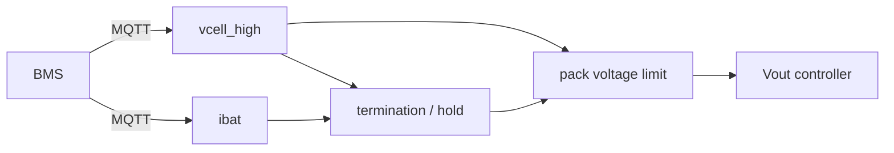

# BMS Integration

The charger subscribes to battery data a BMS publishes over MQTT and regulates on the highest cell voltage instead of
the pack voltage divided by the cell count.

The firmware reads the BMS only from MQTT. A BMS on BLE, CAN bus, or RS485 connects through a bridge that publishes
plain numbers to MQTT, for example [batmon-ha](https://github.com/fl4p/batmon-ha) for Bluetooth BMSes.

## Why use BMS data

With the cell voltages available, the charger keeps the highest cell below the BMS cut-off. This gives the following
benefits:

- no BMS over-voltage cut-off and no disconnect transient,
- more time for cell balancing,
- proper [termination](termination.md) instead of a trickle charge into a full pack.

Without this data, a BMS may disconnect the battery at any time during charging, for example on a cell over-voltage.
Only the fast shutdown limits the resulting transient at the charger output.

## Quick start

To connect the charger to a BMS, run these console commands with your broker, credentials, and topics:

```
set-config mqtt.conf broker_uri mqtt://<broker-ip>:1883
set-config mqtt.conf username <user>
set-config mqtt.conf password <pass>
set-config mqtt.conf cell_voltages_max_topic <bms>/cell_voltages/max
set-config mqtt.conf ibat_topic <bms>/current
svc rs mqtt
status
```

The topic names depend on your BMS bridge. `status` shows the BMS feed (`vcell_high` with its age, `ibat`).

## Topics

Configure the topics in [`mqtt.conf`](../../reference/config/mqtt.md). All payloads are a plain decimal number, for
example `3.412`. The following table lists the topic keys:

| `mqtt.conf` key | Payload | Used for |
|---|---|---|
| `cell_voltages_max_topic` | highest cell voltage, V | pack-voltage pinning, end-of-charge, termination |
| `ibat_topic` | battery current, A, positive while charging | termination, recharge counter, `partial_charge` hold, temperature derating |
| `ibat_lim_topic` | charge current limit, A (≥ 0) | overrides `charger.conf::ibat_max` at runtime |
| `bat_temp_topic` | pack temperature, °C; up to 4 comma-separated topics | `bat_temp_min` / `bat_temp_derate` / `bat_temp_max` policy |
| `bat_charge_topic` | BMS remaining charge, Ah (≥ 0) | charge deficit since full, shared by all chargers on the BMS; see [recharge hysteresis](termination.md#recharge-hysteresis-dod-based-release) |
| `bat_voltage_topic` | pack voltage, V | output wiring resistance fit (with `ibat_topic`); see [wire-fault protection](../../reference/config/limits.md#output-wire-fault-protection) |
| `cell_voltages_delta_topic` | cell-voltage spread (max − min), V (≥ 0) | early end of a [top-balancing](termination.md#top-balancing) run |

A temperature outside −40…100 °C drops that sensor, and a sensor without a frame for 1 h expires.

:::note Non-numeric payloads
The firmware logs and ignores a payload that is not a plain number: empty payloads, text such as Home Assistant's
`unavailable`, numbers with a unit such as `3.4V`, `nan` or `inf`, and payloads of 32 bytes or more. Values out of
range are ignored the same way: a cell or pack voltage ≤ 0, and a negative current limit, charge or cell spread.
An ignored frame on `cell_voltages_max_topic` leaves the last good value in use until it goes stale after 180 s
(see [Stale data and fallback](#stale-data-and-fallback)).
:::

## How the data is used

The following diagram shows how the two BMS feeds reach the Vout controller:



The charger uses the data in three places:

- Pack voltage limit: the charger adjusts the Vout setpoint so that the highest cell stays at `charger.conf::cv_eoc`,
  instead of charging to `vout_max` blind. See [LFP charging](lfp-charging.md).
- Termination: the charger evaluates it on each new cell-voltage frame, and only while both the cell-voltage and the
  current feed are fresh. See [Termination & recharge](termination.md).
- Cell count: the charger derives it from the charger settings as `floor(vout_max / cv_eoc)`.

## Stale data and fallback

A feed is stale when no message arrived for 180 s. `VCELL_EXPIRATION_TIME_SEC` in `src/charger.h` sets this timeout,
and the same timeout applies to `ibat`. The following table shows the output voltage limit in each situation:

| Situation | Output voltage limit |
|---|---|
| Cell voltage fresh and `charger.conf::bat_c` set | regulated on the highest cell |
| Cell topic configured, no data yet (boot) | `Vbat_fallback` |
| Cell data goes stale | glides to `Vbat_fallback` over 5 s |
| Cell data goes stale while charging: highest cell below `cv_float` + 0.05 V, `bat_c` set, not terminated | held at bus voltage + 0.1 V, lowered to `Vbat_fallback` over 600 s |
| No cell topic, or `bat_c` missing | `Vbat_fallback` |

`Vbat_fallback` is `charger.conf::vout_max_fallback`, by default `N_cells × cv_float`. This float voltage does not
overcharge a full pack. The effective limit is never above `charger.conf::vout_max`. See also
[stale cell data](termination.md#stale-cell-data).

:::note
`vout_max_fallback` must be greater than `vout_offset_max` (default 0.6 V). The firmware rejects a smaller value,
including `0`, at boot. Setup fails and the converter stays off, with the console available to fix the file. When BMS
data is missing, the converter holds the fallback voltage. There is no setting that stops it instead.
:::

:::warning
Termination, the `partial_charge` hold, and recharge counting need a fresh `ibat` feed. Without it, the temperature
policy falls back to an output-current limit. Check that both feeds are live in `status`.
:::

## Common scenarios

### Several chargers on one battery

Point every charger at the same BMS topics. Each charger regulates independently on the same highest cell voltage.
Set `bat_charge_topic` as well, so that all chargers count the same charge deficit and leave termination together.

### Limit charge current from the BMS

Publish the allowed current to the topic in `ibat_lim_topic`, for example from a BMS that reduces current near full or
at low temperature. Each message replaces the current limit. The `iset` console command and `charger.conf::ibat_max`
set the same value.

### Verify the link

To check the BMS link, run these commands:

```
status
svc list
```

`svc list` must show `mqtt` running, and `status` must show a fresh `vcell_high`. For topics the device publishes
itself, see [MQTT topics](../../reference/mqtt.md).
