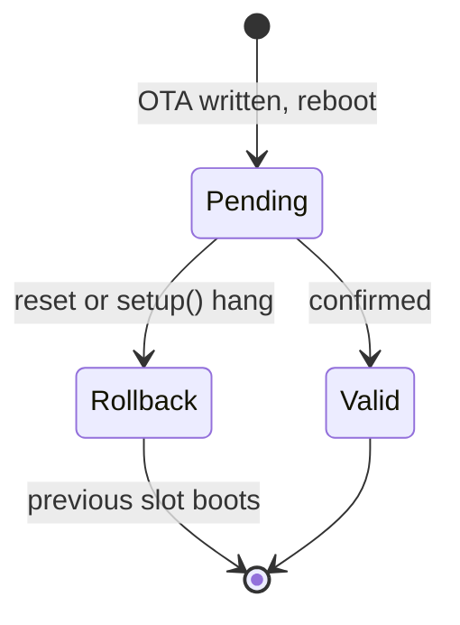

# OTA updates

Devices update their firmware over Wi-Fi by downloading an image from an HTTP(S) URL into the inactive OTA slot.
A freshly updated image must prove itself healthy, or the bootloader rolls back to the previous one.
For devices without Wi-Fi, see [OTA over BLE](ota-ble.md).

## Quick start

Run these commands from the repository root to build the firmware and update devices:

```bash
# ESP-IDF exported, submodules checked out; once: python -m pip install requests
idf.py build
PYTHONPATH=. python etc/ota.py -n              # dry run: discover + show versions only
PYTHONPATH=. python etc/ota.py -m <hostname>   # update devices whose hostname matches
```

`./ota.sh <args>` is a shortcut that runs `idf.py build`, then `etc/ota.py <args>`. It refuses to run (exit 2)
unless the arguments contain `-n`/`--dry-run` or `-m`/`--match`, each as its own word, so it never updates every
discovered device by accident. When `idf.py` is not on `PATH`, it sources the repository's `idf-export.sh` for
the `esp32s3` target.

`etc/ota.py` discovers devices and serves `build/fugu-firmware.bin` on port 9000. It builds the URL from the host IP
as the device sees it, so the update also works when the device sits behind NAT. It then sends `ota <url>` to each
device and prints a table of the versions before and after the update.

`etc/ota.py` accepts these flags:

| Flag | Effect |
|---|---|
| `-n`, `--dry-run` | Discover and show which hosts would update; send nothing |
| `-m REGEX`, `--match REGEX` | Only update devices whose hostname matches |
| `-f`, `--force` | Update even if the device already runs the local build's version |
| `--bootloader` | Push `build/bootloader/bootloader.bin` instead of the app (see [Bootloader update](#bootloader-update)) |
| `--allow-driver-change` | Skip the gate-driver confirmation below |

`etc/ota.py` imports the `etc/fugu` and `etc/idf-devtools` submodules and needs the `requests` package.

Before an app update it reads the build's configuration and asks for a `y/N` confirmation when the image:

- has no networking (`CONFIG_FUGU_WITH_NETW` off), so the devices lose Wi-Fi after the update;
- is a plant-simulation build (`CONFIG_FUGU_WITH_VCONV`), which drives no real half-bridge;
- uses a different gate driver than the device, or either driver cannot be determined;
- is uncommitted (`-dirty` version).

Without a terminal these confirmations are refused and the update aborts; `--allow-driver-change` approves only
the gate-driver one.

:::warning Live converters
An OTA reboots the device into the new image. On converters connected to panels and a battery, run `-n` first
and scope the update with `-m`.
:::

## Manual update

To update a device without `etc/ota.py`, serve the image from any HTTP server the device can reach. For example:

```bash
python3 -m http.server 9000 --directory build
```

Then send the `ota` command to the device:

```
ota http://<host-ip>:9000/fugu-firmware.bin
```

The `ota` [console command](../../reference/console.md) stops conversion itself, waits for the output to
de-energize, and halts the ADC during the download; no `dc 0` is needed. If the download fails and the device does
not reboot, it restores the previous operating mode (MPPT, manual or PSU).

Before the download the device also shuts BLE down and returns its memory to the heap, since every update ends in a
reboot. A BLE console that sent the command loses its link; follow the update over serial, telnet or MQTT. BLE cannot
be restarted without a reboot, so a failed or timed-out download reboots the device into the image it was running.
BLE is kept while a failed [bootloader update](#bootloader-update) blocks restarts.

A watchdog limits the download to 5 minutes. When it expires, the device restarts into the image it was running.

An `https://` URL needs a build with `CONFIG_FUGU_WITH_HTTPS`; the server must have a certificate from the built-in CA
bundle. See [`https://` OTA](../getting-started/build-options.md#https-ota) for heap figures and the URLs that fail.

The command is refused before anything is stopped when Wi-Fi is not connected, or while the running image is still
*pending verify* (see [rollback](#rollback-and-boot-watchdog)): an update can start only after the previous one has
confirmed itself. Check `rollback=` in the `running:` line of `bootinfo` before updating again.

## Rollback and boot watchdog

The bootloader is built with `CONFIG_BOOTLOADER_APP_ROLLBACK_ENABLE=y`, so a new OTA image boots as
*pending verify*. The diagram shows how the image leaves that state:



The confirmation and the watchdog behave as follows:

- `lfMarkOtaValid()` confirms the image only once the real-time loop is proven healthy: at least 20 s uptime and
  the ADC sampler producing samples.
- Confirming writes flash. Without working flash auto-suspend, that write would stall the real-time loop at power, so
  the confirmation waits until the converter is off or its output is below 5 W, for up to 2 h of uptime; after that
  it confirms at power. The device logs `OTA confirm deferred until output < 5 W (a reset now rolls back)` when it
  defers.
- Until the image is confirmed, a reset rolls back to the previous image, and new `ota` and `ota-ble` updates are
  refused. Check that `bootinfo` shows `rollback=VALID` before resetting or updating again.
- A 30 s boot watchdog, armed at the top of `setup()`, restarts the device if setup never finishes. With rollback,
  that restart lands on the previous good slot.
- Images flashed over serial are not *pending verify*, so the confirmation is a no-op there.

:::danger Rollback needs the new bootloader
Rollback is a bootloader feature, and an OTA writes only the app. A device whose bootloader predates rollback
support will brick, not revert, on a bad image. Serial-flash bootloader and app once (keeping the littlefs
partition), or use the [bootloader update](#bootloader-update), to enable rollback. Later OTAs are then protected.
A device that hangs before Wi-Fi comes up can only be recovered over serial.
:::

## Bootloader update

`ota bootloader <url>` replaces the second-stage bootloader over Wi-Fi. Use it to bring a device that was only ever
updated by app OTA up to a bootloader with rollback support. From the repository root:

```bash
idf.py build
PYTHONPATH=. python etc/ota.py --bootloader -n -m <hostname>   # current vs new bootloader
PYTHONPATH=. python etc/ota.py --bootloader -m <hostname>      # asks for confirmation
```

With `--bootloader`, `etc/ota.py` serves `build/bootloader/bootloader.bin`, reads each device's current bootloader
from the `bootloader:` line of `bootinfo`, and skips devices that already have the local image. `-n`, `-m` and `-f`
keep their meaning. It updates one device at a time and refuses to run non-interactively.

:::danger No recovery bootloader
The ESP32-S3 has no recovery bootloader. The final copy rewrites the bootloader region in place; a reset or power
loss during it leaves the device unbootable until it is reflashed over serial. The copy typically takes about half a
second (a few seconds with worst-case flash erase times); run it only with a stable supply.
:::

The device refuses the update unless all of the following hold:

- Conversion is stopped with `dc 0` (manual mode, target 0, converter disabled). The command does not stop the
  converter itself; it checks again after the download.
- The running app is confirmed (not *pending verify*), and flash encryption and secure boot are disabled.
- The image is fully downloaded and verifies: ESP image magic, chip id, segment checksum, and the appended SHA-256.
  ESP-IDF checks only the checksum on bootloader images, so the firmware checks the hash itself.
- The image fits the bootloader region, uses the same SPI flash mode as the installed bootloader, and does not
  declare a flash larger than the chip.

The image is staged in unallocated flash after the last partition, so the passive app slot keeps its rollback image.
An image identical to the installed one is not written. Otherwise the firmware erases only the sectors the image
needs, copies it, and compares the region with the staged image, retrying the copy up to three times. If all
attempts fail, the command reports it and the firmware refuses to restart until a retried update succeeds; resetting
or powering off the device in that state bricks it. ESP-IDF's
protection against writes to the bootloader region stays enabled except during that copy.

The new bootloader runs after the next reset. `bootinfo` reads the bootloader from flash, so it shows the new image
immediately after the update:

```
bootloader: idf <idf-version> v<desc-version>, <build date and time>, len <bytes>, sha <first 16 hex digits>
```

To update without `etc/ota.py`, stop conversion and serve the build directory as in [Manual update](#manual-update):

```
dc 0
ota bootloader http://<host-ip>:9000/bootloader/bootloader.bin
restart
```

## ELF archive

After each verified OTA, `etc/ota.py` archives the build ELF so coredumps from that device can be decoded later.
See [Debugging](../../development/debugging/index.md#coredumps).
