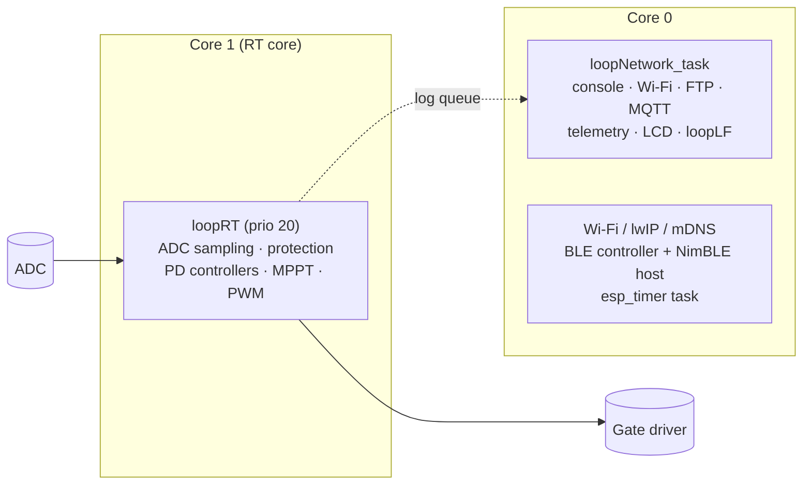
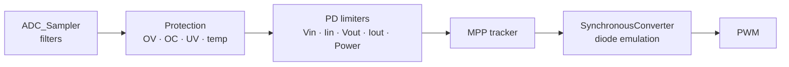

# Architecture

The firmware is an ESP-IDF application with Arduino as a component. It splits work between the two ESP32-S3
cores so that the real-time control loop never shares a core with networking.

## Task layout

The diagram shows which tasks run on each core and how data flows between them.

The table lists what runs on each core and the rules that apply there.

| Core | Runs | Rules |
|---|---|---|
| 1 | `loopRT`: [sampling](sensors.md), [protection](protection.md), [PD controllers](control-loop.md), [MPPT](mppt-tracker.md), [PWM](pwm-drivers.md) | Nothing else is pinned here. The loop blocks on the next ADC sample; never add `vTaskDelay`. |
| 0 | Arduino `loop()` → `loopNetwork_task`: [console](../reference/console.md), Wi-Fi, lwIP, [MQTT](../reference/mqtt.md), [telemetry](../reference/telemetry-fields.md), [BLE](../reference/ble/gatt.md) controller and NimBLE host, `esp_timer` task | All [services](services.md) tick here. |

`sdkconfig.defaults` pins Arduino, Wi-Fi, lwIP, mDNS, MQTT, and the `esp_timer` task to core 0; `sdkconfig.d/ble`
pins the Bluetooth controller and the NimBLE host there too. `loopRT` checks its core at startup.

## Control pipeline

Every new ADC sample runs through `loopRTNewData` → `mppt.update()`:

1. **Sampling** (`src/adc/sampling.h`): async reads, round-robin over channels, with notch, median, and EWMA filters.
   `Vout` is sampled last so the controller reacts to it with minimum latency. See [Sensors](sensors.md) and
   [Signal filters](signal-filters.md).
2. **Protection** (`mppt.protect`, `mppt.protectLf`): hard cut-outs. A violation turns the converter off and arms a backoff.
   See [Protection](protection.md).
3. **PD controllers** (`src/pd_control.h`): the smallest response wins. See [Control loop](control-loop.md).
4. **MPP tracker** (`src/tracker.h`): global sweep, then fast and slow perturb & observe. See [MPP tracker](mppt-tracker.md).
5. **Converter** (`src/buck.h`): computes the low-side on-time. See [Diode emulation](diode-emulation.md) and
   [MCPWM driver](pwm-drivers.md).

## Configuration and state

The firmware keeps configuration and state in three stores.

| Store | Holds | Changed by |
|---|---|---|
| littlefs `/littlefs/conf/*.conf` | Hardware and behaviour, see [Configuration](../reference/config/index.md) | `set-config`, FTP, [provisioning](../guide/getting-started/provisioning.md) |
| NVS | Wi-Fi networks, hostname, runtime state | Console commands |
| Kconfig | Compiled-in features, see [build options](../guide/getting-started/build-options.md) | Rebuild |

## Flash layout

`partitions.csv` defines two OTA slots (`ota_0`, `ota_1`, ~1.87 MB each), a 128 KB `littlefs` partition, and a
`coredump` partition. See [OTA Updates](../guide/updating/ota-wifi.md) for the rollback scheme.

## Source map

The table maps source paths to their contents.

| Path | Contents |
|---|---|
| `src/main.cpp` | `setup()`, task creation, service registration |
| `src/cli.cpp` | Console command dispatcher |
| `src/mppt.*`, `src/tracker.h`, `src/pd_control.h` | Control loop |
| `src/buck.h`, `src/pwm/` | Converter model and gate drivers |
| `src/adc/` | ADC backends and the sampler |
| `src/math/` | Filters and statistics |
| `src/charger.h` | Charge termination, see [charge termination](../guide/charging/termination.md) |
| `src/tele/` | MQTT, telemetry, FTP, Home Assistant |
| `src/service.h` | Service base class |
| `src/sim/` | Virtual converter |
| `etc/` | Host tools: console client, OTA, config editor, scope |
| `config/` | Board configuration images |
| `test/` | Unit tests |

## Internals pages

| Page | Covers |
|---|---|
| [Control loop](control-loop.md) | Loop iteration, limiters, noise versus speed, BMS coupling |
| [Protection](protection.md) | Trip conditions, backoff, ADC and latency watchdogs, start conditions |
| [MPP tracker](mppt-tracker.md) | Global sweep, perturb & observe, when the tracker sweeps |
| [Sensors](sensors.md) | ADC backends, scaling, virtual sensors |
| [Signal filters](signal-filters.md) | Notch, median, and EWMA filter chain |
| [Diode emulation](diode-emulation.md) | Low-side on-time, CCM/DCM transition |
| [MCPWM driver](pwm-drivers.md) | MCPWM synchronous-buck driver |
| [Services](services.md) | Core-0 loop, service lifecycle, Wi-Fi and BLE |
| [DCM coil ringing](dcm-ringing.mdx) | Switch-node ringing in discontinuous mode |
| [LFP longevity](lfp-longevity.md) | What the aging literature says about charge control |
