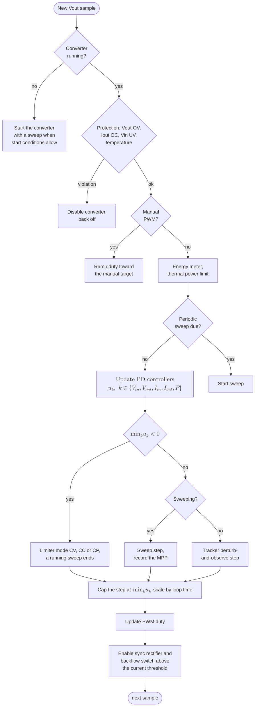

# Control Loop

The control loop reads `Vout`, `Vin`, and `Iin` and adjusts the PWM duty cycle of the converter for MPPT and output
regulation. It runs once per `Vout` reading, which keeps the output voltage response fast.

## Loop iteration

The flowchart shows one iteration of the real-time loop in MPPT mode. PSU and PV-simulator modes replace the tracker
step with a voltage setpoint.

## Limiters

Besides the MPP tracker, the loop contains five PD controllers, which are PID controllers without the integral term:

| Controller | Regulates | Purpose |
|---|---|---|
| `VinCTRL` | Solar voltage | Keeps Vin above the board-supply undervoltage threshold |
| `IinCTRL` | Solar current | Protects the hardware |
| `VoutCTRL` | Battery voltage | Regulates the output when the battery is full or disconnected |
| `IoutCTRL` | Charge current | Set-point from the charging algorithm |
| `PowerCTRL` | Conversion power | Thermal derating, set-point from temperature feedback |

`VoutCTRL` is the fastest controller. It has large coefficients, especially the derivative term, because keeping
the output in range under load changes prevents damage from transient over-voltage. A solar panel behaves like a
current source, so `IinCTRL` and `IoutCTRL` can be slower.

Each iteration updates all controllers and takes the lowest response. If it is positive, MPPT proceeds. Otherwise,
MPPT halts and the duty cycle decreases in proportion to the control value.

The controller gains are set in [`converter.conf`](../reference/config/converter.md#control-loop-gains).

:::caution Known issue
During power-derating / overload, `IoutCTRL` and/or `PowerCTRL` decrease the duty cycle, which can raise the solar voltage and so
increase conversion power. The converter might run into the hard limits, shuts down, and back-off restarts. The situation is
transient and should not damage hardware.
:::

## MPPT algorithm

[MPP Tracker](mppt-tracker.md) describes the sweep, fast and slow perturb and observe, and sweep gating.

## Noise versus speed

Sensor noise grows with power. A slower loop gives a steadier output and avoids repeated false over-voltage or
over-current shutdowns, but it raises the voltage transient on a load step such as a BMS cut-off.

Filtering and loop speed depend on measurement quality and need tuning per board. See
[Signal Filters](signal-filters.md).

## BMS coupling

When the charger can read the highest cell voltage from the BMS over MQTT, it regulates the output so the BMS never
reaches its over-voltage cut-off. This avoids the voltage transient at the output that occurs when a BMS disconnects
the battery, which it may do at any time during charging. It also shortens balancing and prevents trickle charging.
See [Charge Termination](../guide/charging/termination.md).

## Further reading

These resources cover converter control and related topics:

- CCM/DCM: see `power supply.md` in the [Fugu2](https://github.com/fl4p/Fugu2) repository
- [Microchip EPC9151 power boost, average current mode control](https://mplab-discover.microchip.com/v2/item/com.microchip.code.examples/com.microchip.ide.project/com.microchip.subcategories.modules-and-peripherals.analog.adc-modules.adc/com.microchip.mplabx.project.epc9151-power-boost-acmc/1.0.1?view=about&dsl=EPC9151-power)
- [PID auto tuning (video)](https://www.youtube.com/watch?v=fv6dLTEvl74)
- [Data-driven DC/DC model](https://github.com/KrupaPrag/DCDC_BuckBoostConverter)
- [Microchip PowerSmart DCLD](https://microchip-pic-avr-tools.github.io/powersmart-dcld/)
- [DC/DC control (video)](https://www.youtube.com/watch?v=6brnVTfCp7A)
- [MDPI Electronics 13(16):3207](https://www.mdpi.com/2079-9292/13/16/3207)
- [Microchip DPSK3 buck voltage-mode control](https://microchip-pic-avr-examples.github.io/dpsk3-power-buck-voltage-mode-control/a01655.html)
- Search term: "voltage regulator control loop design"
