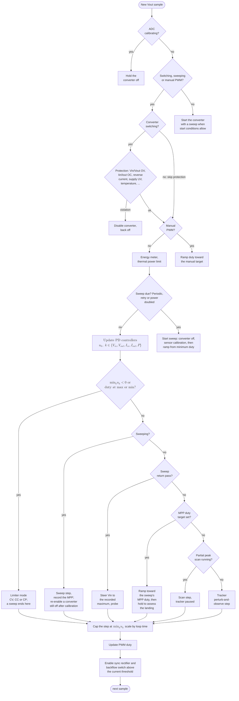

# Control loop

*Original hand-written notes: [doc/Control Loop.md](https://github.com/fl4p/fugu-mppt-firmware/blob/main/doc/Control%20Loop.md) and the README section [Control Loop](https://github.com/fl4p/fugu-mppt-firmware#control-loop).*

If you are new to PID control, watch MATLAB's [What Is PID Control? (video)](https://www.youtube.com/watch?v=wkfEZmsQqiA) first.

The control loop reads `Vout`, `Vin`, and `Iin` and adjusts the PWM duty cycle of the converter for MPPT and output
regulation. It runs once per `Vout` reading, which keeps the output voltage response fast.

## Loop iteration

The flowchart shows one iteration of the real-time loop in MPPT mode. PSU and PV emulator modes replace the tracker
step with a voltage setpoint.

The protection checks also run on every new sample of the other channels; only the control step waits for a new
`Vout` sample. [Protection](protection.md) describes the protection step and its trip conditions.

Sweeps are held off while the battery is full or in CV, in PSU mode, during a back-off, or while a flash write is pending.
At the maximum duty the loop steps down in CV mode; at the minimum duty outside a sweep it steps up.
[MPP Tracker](mppt-tracker.md) describes the return pass, the landing check and the partial peak scan.

## Limiters

Besides the MPP tracker, the loop contains five PD controllers, which are PID controllers without the integral term:

| Controller | Regulates | Purpose |
|---|---|---|
| `VinCTRL` | Solar voltage | Keeps Vin above `limits.conf::vin_min` so the source does not collapse; a buck in DCM also keeps Vin above Vout divided by the LS minimum-pulse start ratio (about 1.18 × Vout on typical boards). The hard supply undervoltage stop (~9 V) is a separate trip |
| `IinCTRL` | Solar current | Protects the hardware |
| `VoutCTRL` | Battery voltage | Regulates the output when the battery is full or disconnected |
| `IoutCTRL` | Charge current | Set-point from the charging algorithm, including the BMS current limit, the CV-hold limit and the wire-guard cap |
| `PowerCTRL` | Conversion power | Limits power to `limits.conf::p_max`, derated linearly from `temp_derate` to `temp_max`, and to 25 % while the NTC reads no value |

`VoutCTRL` is the fastest controller. It has large coefficients, especially the derivative term, because keeping
the output in range under load changes prevents damage from transient over-voltage. A solar panel behaves like a
current source, so `IinCTRL` and `IoutCTRL` can be slower.

Each iteration updates all controllers and takes the lowest response. If it is positive, MPPT proceeds. Otherwise,
MPPT halts and the duty cycle decreases in proportion to the control value.

A limiter that only touches for less than
250 ms, without passing its set-point, does not restart the tracker: the following iterations give back the duty it
took, and tracking carries on.

The controller gains are set in [`converter.conf`](../reference/config/converter.md#control-loop-gains).

:::caution Known issue
During thermal derating or an overload, `IoutCTRL` or `PowerCTRL` lowers the duty cycle. Below the MPP voltage this
raises the solar voltage and the conversion power. The converter can then reach a hard limit, shut down, and restart
with a sweep after the back-off. The situation is transient and should not damage hardware
([#70](https://github.com/fl4p/fugu-mppt-firmware/issues/70)).
:::

## MPPT algorithm

Tracking has three phases: a global sweep from minimum duty that records the MPP, then fast and later slow perturb
and observe around it. A major change in power switches back to fast tracking. A new sweep runs every 30 minutes, so
the tracker does not stay on a local maximum of a partially shaded string.
[MPP Tracker](mppt-tracker.md) describes the phases, the sweep gating and the partial peak scan.

## Noise versus speed

Sensor noise grows with power. A slower loop gives a steadier output and avoids repeated false over-voltage or
over-current shutdowns, which waste solar energy, but it raises the voltage transient on a load step such as a BMS cut-off.

Filtering and loop speed depend on measurement quality and need tuning per board, except the inverter-ripple
notch, which tunes itself. See [Signal filters](signal-filters.md).

## BMS coupling

When the charger can read the highest cell voltage from the BMS over MQTT, it regulates the output to stay below the BMS
over-voltage cut-off. This avoids the voltage transient at the output that occurs when a BMS disconnects
the battery, which it may do at any time during charging. It also shortens balancing and prevents trickle charging.
A disconnect can still happen, for example on a BMS fault, so sensitive loads need their own over-voltage protection.
See [Charge Termination](../guide/charging/termination.md).

## Further reading

- CCM/DCM: see `power supply.md` in the [Fugu2](https://github.com/fl4p/Fugu2) repository
- [Microchip EPC9151 power boost, average current mode control](https://mplab-discover.microchip.com/v2/item/com.microchip.code.examples/com.microchip.ide.project/com.microchip.subcategories.modules-and-peripherals.analog.adc-modules.adc/com.microchip.mplabx.project.epc9151-power-boost-acmc/1.0.1?view=about&dsl=EPC9151-power)
- [Data-driven DC/DC model](https://github.com/KrupaPrag/DCDC_BuckBoostConverter)
- [Microchip PowerSmart DCLD](https://microchip-pic-avr-tools.github.io/powersmart-dcld/)
- [MDPI Electronics 13(16):3207](https://www.mdpi.com/2079-9292/13/16/3207)
- [Microchip DPSK3 buck voltage-mode control](https://microchip-pic-avr-examples.github.io/dpsk3-power-buck-voltage-mode-control/a01655.html)
- [PID controller explained (video)](https://www.youtube.com/watch?v=fv6dLTEvl74)
- [DC/DC control (video)](https://www.youtube.com/watch?v=6brnVTfCp7A)
