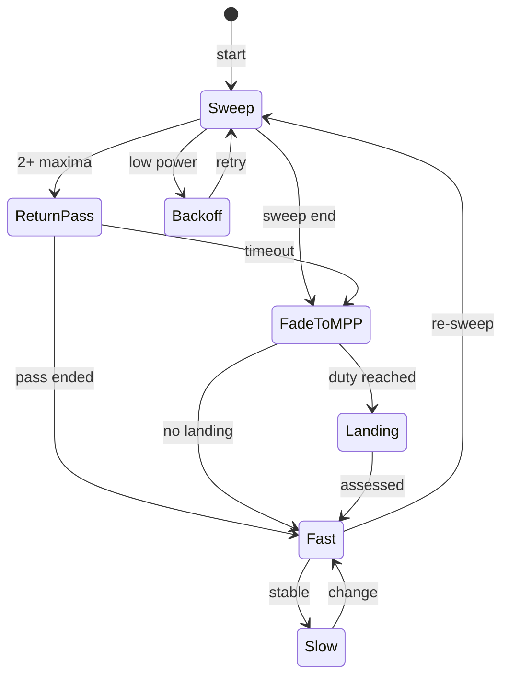
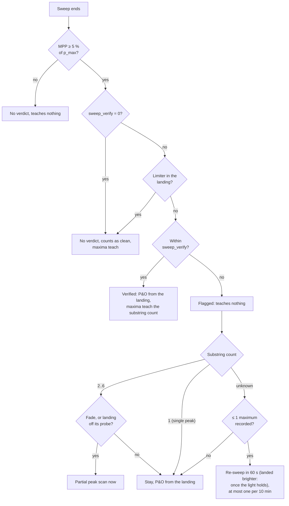
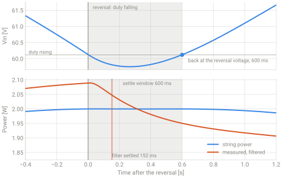
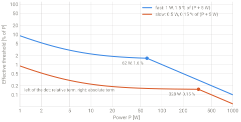
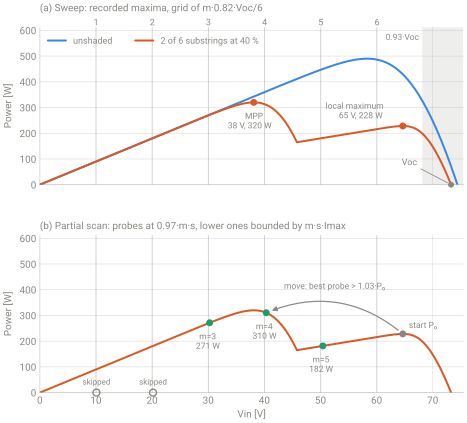

# MPP tracker

*Original hand-written note: the README section [MPPT Algorithm](https://github.com/fl4p/fugu-mppt-firmware#mppt-algorithm).*

The tracker finds and follows the maximum power point (MPP) of the solar input by moving the converter duty cycle.
It runs inside the [control loop](control-loop.md) only while no limiter is active.

## Phases

Tracking runs in three phases:

1. Global sweep: the duty cycle rises from 0 and the tracker captures the MPP. The sweep ends when a limiter
   becomes active (input undervoltage, output overvoltage, overcurrent, power limit) or the duty reaches its maximum.
2. Fast tracking: perturb & observe (P&O) around the captured MPP.
3. Slow tracking: P&O with a lower rate, smaller steps, and a smaller mean tracking error. A new power maximum,
   a major drop in power (clouds, partial shading), a limiter, or 45 s without a direction reversal switches
   back to fast tracking.

A new global sweep runs every 30 minutes so the tracker does not stay on a local maximum, which happens with
partially shaded strings. A sweep takes about 5–15 s, longer when a limiter holds the ramp back (see
[Global sweep](#global-sweep)). Sweeping too often or too slowly costs yield. On a buck, once a sweep has shown a
shaded string, a [partial peak scan](#partial-peak-scan) checks the other local maxima in a few seconds (at most
2.6 s per probe), every 5 minutes and after a sustained change.

In low light, power changes between P&O steps stay below the tracker's thresholds, so P&O cannot follow an
MPP that moves while the light changes (see [Perturb & observe](#perturb--observe)). If the last sweep
captured less than 5 % of `limits.conf::p_max`, the tracker therefore starts another sweep once power has
doubled since that sweep, at most every 2 minutes. At dawn this adds a few short sweeps while the power is
still low.

The following state diagram shows the transitions between the phases:



| Transition | Label | Condition |
|---|---|---|
| → Sweep | start | Boot, `sweep` command, 30 min, low-light power ×2, or re-sweep |
| Sweep → ReturnPass | 2+ maxima | Limiter or max duty on a bright buck sweep with 2+ local maxima above 1.05 times the Vin floor, at most 6 recorded (see [Return pass](#return-pass)) |
| Sweep → FadeToMPP | sweep end | Limiter or max duty, otherwise |
| Sweep → Backoff | low power | Best power < 0.2 % of `p_max` |
| ReturnPass → Fast | pass ended | Landed on the best probe, or a limiter stopped it (no landing) |
| ReturnPass → FadeToMPP | timeout | 30 s timeout; fades to the captured duty, no landing |
| FadeToMPP → Landing | duty reached | Target duty reached |
| FadeToMPP → Fast | no landing | Stopped by a limiter, or duty reached after a timeout |
| Landing → Fast | assessed | Power settled (trim, verdict), or a limiter took over (no verdict) |
| Fast → Slow | stable | P > 2 W, no new MPP for 30 s, last takeover > 30 s ago and reversed since, last reversal < 45 s ago |
| Slow → Fast | change | New MPP, MPP reset, 45 s without reversal, limiter, or P ≤ 0.5 W |
| Fast → Sweep | re-sweep | Flagged sweep or Vout-cap re-sweep |
| Backoff → Sweep | retry | Next start, or Vout cap lifted |

## Global sweep

A sweep (`startSweep()` in `src/mppt.h`) runs these steps:

1. It disables the converter, clears the fade target, and resets the PD controllers.
2. It starts a sensor calibration. The periodic re-sweep doubles as periodic calibration. After a failed
   calibration the next sweep skips it and runs on the old zero offsets, so a persistent failure does not block
   every start.
3. Once calibration is done, it raises the duty each tick. `sweep_speed` caps the step, and the distance to the
   nearest limit scales it, so the ramp slows down when approaching a Vout, current or power limit. At the default
   `sweep_speed` 4 the plain ramp covers the whole duty range in 10 s. The Vin floor does not slow it: the sweep ends
   when Vin crosses the floor.
4. Over every 1/128 of the duty range, or each move of Vin by $V_{oc}/256$, the sweep measures how far Vin moved.
   Where Vin moved less than Voc over the whole duty range would, the step grows by up to `sweep_pace` (default 4,
   1 = off, at most 8), so the ramp runs at a more even pace in Vin: fast near Voc, where the converter barely draws
   current, and on the flat high-duty end towards the floor. The steep stretch past the MPP keeps the plain step. The
   speed-up fades out between no load and half the power limit, and a Vout that moves without a battery holding it
   (open output) turns it off.

   The sensor filters lag the ramp, so the speed-up is also bounded by their delay: the ramp may move at most 1/64 of
   the duty range per filter delay $\tau = (\text{span} + 1) / f_s$ of the slowest of Vin, the power current and the
   power voltage (median-of-5 plus a two-pass EWM). At the base step (`sweep_speed` 4, 10 % of the duty range per
   second) this allows a speed-up of $0.156 / \tau$ [s]: 3.8 at 512 sps and span 20, the full 4 at 1470 sps, 1.1 at
   450 sps and span 60, and none at 125 sps and span 60.
5. In dim light the input capacitance matters. While Vin falls, the input caps discharge into the converter, and the
   measured power is the string's plus $C_{in} V \, |dV/dt|$: 1 mF at 50 V and 40 V/s adds 2 W to a 4 W string. Over
   the same window the sweep keeps this term under 5 % of the measured power by slowing the ramp, down to 1/32 of the
   base step, once the power reaches `sweepMinPower()` (step 6). $C_{in}$ is `converter.conf::c_in` (default 1 mF).
   It should match the board's real input capacitance (two 470 µF capacitors on the standard board).
6. It records the sample with the highest power, less the discharge term, as the MPP, with the smoothed Vin (filtered
   like the power, so with equal filters the two refer to the same moment) and the local Vin slope per duty count. It ignores samples
   below 0.2 % of `limits.conf::p_max` (2 W at 1 kW, `sweepMinPower()`), so a sweep in marginal light cannot "peak"
   at a near-maximum-duty phantom point.

The sweep stops as soon as any limiter produces a control mode (CV, CC, or CP), including the bounce at the maximum
duty. The captured MPP duty becomes the target, and the loop fades to it with a bounded step before handing over to
P&O. A bright sweep on a buck that recorded two or more local maxima takes the [return pass](#return-pass) instead
of the fade (conditions below).

At the end of a sweep, the firmware writes "MPP Scan done" to the LCD and logs
`Stop sweep <s>s mode=<mode> (lim=<i> tgt=<target> act=<actual>) PWM=<duty> MPP=(<W>,<duty>,<V>)`. `lim` is the
index of the limiter that was active when the sweep ended (the [`cv_lim_idx`](../reference/telemetry-fields.md#cv_lim_idx)
numbering) with its target and actual value. A sweep that ended at the duty bound with no limiter active logs
`lim=-1 tgt=nan act=nan`.

On a buck with the backflow switch open, a sweep that reaches the conversion-ratio limit (Vin near Vout) with less
than 0.05 A of current has no more power to find. It ends there like any other sweep, not as a fault.

### Return pass

The sweep records the local maxima of the power that have a dip of about 8 % on both sides (see
[Substring count](#substring-count)). When a bright sweep (MPP at least 5 % of `limits.conf::p_max`) on a buck has
recorded two or more of them above 1.05 times the input voltage floor, the captured MPP counted as one, the way back
up from the bottom of the sweep measures them again, lowest Vin first (a boost has no return pass):

1. The loop steers Vin to the recorded Vin of the maximum, as the [partial peak scan](#partial-peak-scan) steers to
   a probe. Maxima below 1.05 times the input voltage floor are skipped.
2. Once Vin is within 1 % of it (or after 1.5 s), it waits for the power filter to settle (`powerSettleMs()`, at most
   1 s) and averages the power for 100 ms. Vin is at rest then, so the input caps neither discharge nor charge, and the
   probe compares directly with the down-pass value, from which the discharge term was removed.
3. After the last probe it steers to the best one and measures there again (the landing).

The pass never goes above the highest recorded maximum, so it does not return towards $V_{oc}$. A limiter that acts
during the pass ends it without a verdict, as it stops a fade; at the bottom of the sweep the loop may still lower the
duty while the limiter reports CV. A pass not done after 30 s ends with a fade to the captured duty. P&O then starts
afresh at the landing point. The probes rank the maxima under the light of the moment, a few seconds after the sweep,
so a cloud edge during the sweep does not decide which maximum the converter settles on. The log shows each probe
and the landing:

```
sweep return: 56.6 V 327.4 W, down 327.3 W (+0 %)
sweep return: 74.7 V 302.5 W, down 440.5 W (-31 %)
sweep return: landed 56.6 V 327.8 W, best probe 327.4 W
```

### Landing trim

Vin lags the ramp. Near the MPP in discontinuous mode the converter loads the string like a resistor
$V_{mp}/I_{mp}$, in parallel with the string's own dynamic resistance, which equals the same value there. The input
capacitance therefore settles with $\tau = C_{in} V_{mp}^2 / (2 P_{mp})$, 0.31 s with 1 mF at 50 V and 4 W, so in
dim light the captured duty lies tens of counts past the MPP. The captured Vin does not: the string's power depends on
Vin alone, and the recorded power has the discharge term removed.

After the fade reaches the captured duty, the loop holds the duty until the power filter has settled (as for the
verdict below). P&O is paused meanwhile; the limiters stay in charge, and one that acts ends the assessment
unverified. If the smoothed Vin then differs from the captured one by more than 3 %, the loop moves the duty once by
half the difference over the captured Vin slope (at most 1/64 of the duty range), holds and settles again, and then
gives the verdict. The slope is taken while the caps lag, so the full step tends to overshoot. Afterwards P&O starts
afresh from the settled power, heading towards the captured Vin.

A sweep bright enough for a verdict has a short lag, so if its landing power already misses the MPP by more than
`sweep_verify`, the light changed and it gets the verdict without a trim. The log shows

```
sweep landed 49.1 V 5.3 W, MPP 55.1 V 6.4 W
sweep landing trim 341 -> 290
```

### No-MPP backoff

If the best captured power is below 0.2 % of `limits.conf::p_max` (`sweepMinPower()`, step 6 of the
[sweep](#global-sweep)), the sweep commits no target. The converter shuts down for 30 s and
resumes through the normal start path. The firmware logs this backoff at info level as
`backoff 30s [sweep-no-mpp]`, not as a fault. Each consecutive sweep without an MPP doubles the backoff (60, 120,
240 s) up to 300 s, so a dawn or a source that cannot deliver that power, such as a current-limited bench supply,
retries every 5 min. A sweep that finds an MPP, or a battery reconnected during the backoff (see
[protection](protection.md)), resets the backoff to 30 s.

### Vout cap re-sweep

The Vout cap can end a sweep before it captures any power, when the battery already sits above the cap. After a
reboot, for example, the cap holds `vout_max_fallback` until BMS cell data arrives. Such a no-MPP backoff ends as soon
as the cap rises 0.2 V above both the cap that ended the sweep and Vout (log
`Vout cap <V> V lifted to <V> V, no-MPP backoff cleared`), and a sweep starts right away. It skips the start-up wait
for the BMS termination decision, which takes several cell frames and would otherwise end only on its 12 s timeout.

A sweep that found an MPP but was cut by the Vout cap while BMS cell data was missing is swept again too. Once cell
data is valid, the termination decision is made and no charge hold is active, a cap more than 0.2 V above the one
that cut the sweep schedules a re-sweep 3 s later (log `sweep cap <V> V lifted to <V> V`). It counts against the
one re-sweep per 10 minutes of the [sweep verdict](#sweep-verdict).

### Sweep verdict

A sweep takes several seconds. If the irradiance changes meanwhile, the recorded curve mixes two sky states: its
maximum can be a cusp where the light changed, far above or below the real curve, and on a string with several
local maxima a distorted curve can rank the wrong one highest. P&O cannot cross the power valley to a higher
maximum.

The verdict compares what the sweep recorded with what the converter measures afterwards:

* After a [return pass](#return-pass): each probe with the down-pass power at that maximum, and the landing with the
  best probe.
* After a fade: once the fade reaches the captured MPP duty (and the [landing trim](#landing-trim)), the loop waits
  for the power filter to settle (`powerSettleMs()`, 1.5 to 3 s) and compares the smoothed power with the captured MPP
  power.

If any of these differs by more than `tracker.conf::sweep_verify` (default 0.10, 0 = off), the sweep is flagged. Both
passes and the landing agreeing make a clean sweep. The converter stays at the landing point and P&O carries on from
there. A flagged sweep:

* does not teach the [substring count](#substring-count);
* starts a [partial peak scan](#partial-peak-scan) as soon as the scan has its reference, if a substring count is
  known and the light may have hidden a maximum: after a fade (a changing sky can flatten the dip between two maxima,
  so the sweep records only one), or when the landing after a return pass misses its own probe (the light changed
  during the pass too). After a return pass whose landing agrees, the probes have already ranked the maxima afresh.
* is swept once more if it recorded at most one maximum and no substring count is known: the scan has nothing to
  probe, and the changing sky may have hidden a second maximum. The re-sweep follows 60 s later, or, when the landing
  was brighter than the MPP, 5 s after the input current stops rising (at most 60 s). At most one re-sweep runs
  per 10 minutes, so a gusty sky does not keep the converter sweeping. A re-sweep that another sweep pre-empts does
  not count.

Otherwise a flagged sweep is not repeated. On a string with one maximum P&O finds the MPP from the landing point by
itself; on a string with several, a maximum that the sweep did not record is found by the scan, or by the next
periodic sweep. A string known to have a [single peak](#substring-count) (`pv_substrings=1`) is never re-swept: the
landing check is its only verdict.



A sweep whose fade or return pass a limiter stops, or that lands in a limit, gets no verdict and counts as clean;
its maxima still teach. So does every bright sweep with `sweep_verify=0`. A sweep whose MPP is below 5 % of
`limits.conf::p_max` gets no verdict either and teaches nothing: in low light the captured MPP is the largest of
noisy samples, biased high by tens of percent. The log shows one
line per decision:

```
sweep verified: landed 468 W, off by -0 %
sweep flagged: landed 328 W, off by -31 %
re-sweep in 60 s
sweep flagged: landed 302 W, off by -36 %, scan now
sweep not verified (limiter)
```

The verdict and the landing power also appear in the `sweep-curve` header
([Console](../reference/console.md)).

## Perturb & observe

`Tracker::update()` (`src/tracker.h`) averages power and Vin over one tracker period, then compares the period
mean with the last reference power. These rules set the direction:

- If the power change exceeds the absolute or relative threshold and is negative, the direction reverses, unless
  Vin moved more than 1 % against the steering since the last reversal (up while the duty rises, down while it
  falls). Then the drop did not come from the step, and only the reference power follows it. The exception does
  not apply for 3 s after a limiter hand-back (see
  [Plant moving against the step](#plant-moving-against-the-step)).
- After a reversal, the tracker does not judge the power change during a settle window. The reference power
  follows the measurement instead. The filtered power still lags behind the old direction, and the input
  capacitor discharges while Vin falls and charges while it rises, so the output power dips right after a turn
  toward higher Vin. A decision in that window would reverse again, mostly toward lower Vin. A hand-back from a
  limiter to P&O starts the same window.
- If Vin moved by more than 5 % since the last reversal in the steered direction, the direction reverses as well.
  Within 3 s of a limiter hand-back, a 5 % move in either direction counts.
  This handles cloud recovery, because tracking a light transient can drift far from the MPP. The 5 % refers to
  the higher of the two voltages, so a leg down and the following leg up have the same length.
- Below 1 W, the tracker always increases duty.

In low light the power change across one 5 % leg near the MPP is about 1 % of the power, below the
thresholds and close to the current-sensor noise. The tracker then oscillates within the 5 % band around
where it is. Both rules above keep that oscillation free of a bias toward the battery voltage. A band
measured from each leg's start (5 % down, then 5 % of the lower voltage up) would end every cycle 0.25 % lower,
and judging the power right after a turn would walk Vin down in the same way.

### Settle window

The window applies in fast mode and lasts until both of these hold, but never longer than 1 s (past that, a
reversal still waits while Vin is more than 1 % against the steering, see
[Plant moving against the step](#plant-moving-against-the-step)):

- The power filter has settled. Each power sensor (current and voltage) has a median of 5, which delays a
  step by 2 samples, and a 2-pass EWMA with span $N$, so each pass has a time constant of $\tau \approx N/2$
  samples. The EWMA step response reaches 99 % after $6.64\,\tau$. At the sensor's sample rate $f_s$, the
  settling time is $t_f = (3.32\,N + 2) / f_s$. The slower of the two sensors sets $t_f$. The sample rate is
  the one the sampler uses to tune the sensor's notch filter (see [Signal filters](signal-filters.md)).
- Vin is back at the voltage of the reversal. In low light the input capacitor makes Vin lag the duty by
  about $C V / (2.5\, I)$, for example 0.34 s with 470 µF at 2 W and 60 V. Vin keeps moving in the old
  direction for a moment, then turns. When it gets back to the reversal voltage, the capacitor current has
  mostly reversed. This measures the plant lag directly, so the capacitance does not need to be configured.



*Model of a reversal at 2 W: string $P(x) = P_m(1 - 9x^2)$ with the MPP at 60 V, 470 µF input capacitance, converter
conductance ramped at ±12 %/s, power filter median-5 + 2-pass EWMA (span 20, 450 Hz). The filter settles after
152 ms; Vin returns to the reversal voltage after 600 ms, which ends the window. While Vin rises, the measured power
stays below the string power by the capacitor charging power.*

| Power sensor profile                  | $f_s$  | $N$ | $t_f$   |
|---------------------------------------|--------|-----|---------|
| INA226, 1.1 ms conversion             | 450 Hz | 20  | 152 ms  |
| INA226 at its slowest rate            | 200 Hz | 20  | 342 ms  |
| INA226, filter length 60              | 450 Hz | 60  | 447 ms  |
| ADS1015, three muxed channels         | 120 Hz | 60  | 1 s (capped from 1.7 s) |

A limiter hand-back starts the window but does not count as a reversal. It is a takeover for the slow-mode
condition below: it ends slow mode, and the tracker continues in fast mode for at least 30 s after a derate,
a CV hold, or a sweep.

The 1 s cap bounds a leg that the tracker walks without judging power, as long as Vin stays within 1 % of the
reversal voltage.

Slow mode has no settle window. It evaluates every 500 ms, so a window there can only end at an evaluation, and
any window that covers one skips it: the leg runs a whole period longer, and twice as long in total.
Without the window, the first slow evaluation compares against a reference that still carries the filter lag
and the input-capacitor current. That costs little because the slow-mode slew is 25 times slower than in fast
mode. The capacitor power $C V \, dV/dt$ scales with the slew. In slow mode it is a few mW (470 µF at 60 V), below
the slow-mode threshold of 0.15 % of $(P + 5\,\text{W})$, which is 10.5 mW at 2 W.

The Vin condition has no deadband.

The tracker keeps its own MPP record. It resets the record after 5 min, or when the current power is below 85 % of
the recorded MPP and the record is more than 30 s old (`Reset maxPower <record> (P=<power>)`). A period whose
power exceeds the record by 0.5 % replaces it, which includes the first period after a reset.

Fast and slow mode use these parameters:

| Parameter              | Fast mode | Slow mode |
|------------------------|-----------|-----------|
| Update rate            | 30 Hz     | 2 Hz      |
| Step (control value)   | 0.5       | 0.02      |
| Min. power step, abs.  | 1.0 W     | 0.5 W     |
| Min. power step, rel.  | 1.5 %     | 0.15 %    |

The mode is decided once per tracker period, after the MPP record is updated. The tracker enters slow mode when
all of these hold:

- Power is above 2 W (0.5 W to stay, hysteresis).
- No new MPP was recorded for 30 s.
- The last takeover is more than 30 s ago, and the direction reversed since then. A takeover is a limiter
  hand-back, which includes the end of the fade after a sweep and the start-up.
- The last reversal is less than 45 s ago.

Slow mode ends on a new MPP record (a 0.5 % gain, or the first period after a reset), on a takeover, when power
falls to 0.5 W or below, and 45 s after the last reversal. Moving one way for that long means the MPP has moved.

The MPP record reset is evaluated before the entry, so the tracker does not enter slow mode in the same period in
which the record is about to be reset. The 5-minute record reset also ends slow mode: the record is at least 30 s
old at entry, so a slow-mode episode lasts at most about 270 s.

On entry to slow mode the tracker returns the distance from the current duty to the duty of the recorded MPP
in place of a step. The control loop applies it like any control value, scaled with the slew rate and the
loop period and capped by the limiters, so the duty moves by a small fraction of that distance. The log shows
the duty before and after that tick (`Slow mode, duty <from> -> <to> (<step>, MPP duty <d>, P=<W>)`).

The console command `speed <x>` (0 ≤ x < 10) scales the tracker step (default 1.0).

### Plant moving against the step

P&O on the duty assumes that Vin follows it: more duty, lower Vin. Near the boundary between DCM and CCM ($D \approx M$) on a
low-impedance output this does not always hold. The switch-node ring after the coil current reaches zero leaves a
current in the coil at the next high-side turn-on, and its value depends on the idle time, which shrinks as the
duty rises. Over a span of the PWM period just below $D = M$ the extra on-time is cancelled: Vin barely follows the
duty, $P(D)$ is flat with a shallow local maximum whose dip lies below both power thresholds, and at an unchanged
duty Vin can step down by several volts within a fraction of a second.

When such a step comes while the tracker steers Vin up, a 5 % Vin rule that counted moves in either direction
would reverse it toward lower Vin. Repeated, that leaves the tracker on the local maximum, far below the MPP, until
the next sweep. The 5 % rule therefore counts only a move in the steered direction.

A power drop that coincides with such a step could reverse the tracker the same way. As a guard, a power drop does
not reverse while Vin is more than 1 % against the steering. The 1 % margin keeps reversals on light changes that
move Vin. In DCM the converter input acts like a resistance, so dimming light lowers Vin and power together. Without
a margin, the guard would block every reversal of a leg toward higher Vin and none toward lower Vin, and the
tracker would ratchet up the steep side of the P-V curve. In CCM against a stiff battery, $V_{in} = V_{out}/D$ does
not move with the light, and only the power drops.

Both exceptions start 3 s after a limiter hand-back. The fade back to the sweep's MPP, or the limiter step before
the hand-back, still moves Vin when P&O takes over, so the Vin at the hand-back is no reference. Vin can overshoot
it by more than 1 %, and the direction at the hand-back is that of the last fade step. Blocking reversals there
would hold the tracker off the MPP.

In normal tracking a leg crosses the MPP, so Vin is past the last reversal point when the power drops, and neither
exception changes anything. They do not help a tracker that sits on a flat P-V curve far below the MPP while Vin
follows the duty, for example with bypass-diode humps.

### Thresholds

The tracker reverses when the power change exceeds the absolute threshold $\Delta P_\text{abs}$ or the relative
threshold $\theta_\text{rel}$ applied to $P + 5\,\text{W}$ (only while $P > \Delta P_\text{abs}$), so the smaller of
the two sets the effective relative threshold:

$$
\theta_\text{eff} = \frac{\min\left(\Delta P_\text{abs},\; \theta_\text{rel}\,(P + 5\,\text{W})\right)}{P}
$$

$\theta_\text{eff}$ is larger at low power and smaller at high power. Below about 62 W in fast mode and 328 W in
slow mode the relative term is the smaller one.

In steady light the operating point wanders in a band below the MPP set by the threshold. The resulting threshold
loss is $\theta/3$ to $2\theta/3$ of the power; for the relative thresholds alone:

| Mode | $\theta$ | $\theta / 3$ |
|------|----------|--------------|
| Fast | 1.5 %    | 0.5 %        |
| Slow | 0.15 %   | 0.05 %       |



*$\theta_\text{eff}$ from the tracker's thresholds. The dots mark where the absolute term takes over. The
threshold loss is $\theta_\text{eff}/3$ to $2\theta_\text{eff}/3$.*

## Partial peak scan

A string of modules with bypass diodes has one local power maximum per number of conducting substrings. When
the $m$ strongest of $n$ substrings conduct at their own MPP and the others are bypassed, the maximum sits near
$m$ unshaded substring MPP voltages, lower by the forward drops of the conducting bypass diodes. A maximum at
which weaker substrings also conduct sits higher: the stronger substrings carry the current of the weakest
one, above their own MPP voltage. Two 60-cell modules in series have $n = 6$. P&O climbs the maximum it starts
on and stays there until the next global sweep, even when another maximum is higher.



*Model: two 60-cell modules in series (6 substrings with bypass diodes), two substrings at 40 % irradiance.
(a) The sweep records the maxima below $0.93\,V_{oc}$; on the grid of $m \cdot 0.82\,V_{oc}/6$ they fit
$n = 6$. (b) A scan from the 65 V maximum probes $0.97\,m\,s$ for $m$ = 3 to 5, skips $m$ = 1 and 2 by the
current bound (step 2 below) and moves to $m = 4$.*

`PeakScan` (`src/peak_scan.h`) probes one voltage per candidate maximum. It needs the number of substrings $n$,
which it learns from the global sweeps (below), and a buck converter (no-op on boost). It runs in tracking mode
only (no limiter, sweep, fade, charge hold, rect-cal run, manual, PSU or PV emulator mode), above 5 % of
`limits.conf::p_max`:

1. Candidates: the unshaded substring share is estimated as $s_0 = k\,V_{oc}/n$, with $V_{oc}$ the input voltage at the
   start of the last global sweep (converter off) and $k = V_{mpp}/V_{oc}$ taken from the sweep's maximum when it lies
   in 0.74..0.86 (an unshaded string); otherwise the last value is kept (0.82 at start). The operating point is assigned
   to the nearest multiple $m_0$ of $s_0$. $V_{in}/m_0$ overestimates the share when weaker substrings conduct at the
   operating point, $s_0$ misses heating since the sweep and the spread of $V_{mpp}/V_{oc}$; the scan uses their mean
   $s = (V_{in}/m_0 + s_0)/2$.

   A lower candidate ($m < m_0$) is placed at $0.97\,m\,s$, on the flat low-voltage side of
   its maximum. A higher one ($m > m_0$) is placed at $1.015\,m\,s$: it includes substrings weaker than any at the
   operating point, which lifts it above $m$ shares, and below such a maximum the power falls about in proportion to the
   voltage (the weak substring limits the current).

   A candidate below 1.05 times the input voltage floor (the input
   undervoltage limit, and on a buck the start ratio of the low-side minimum pulse, about $1.2\,V_{out}$), or above
   $0.95\,V_{oc}$, is skipped.
2. A lower candidate ($m < m_0$) delivers at most $m\,s$ times the largest current seen since the last sweep
   (the sweep passes every maximum). If that is below the present power plus the margin, the candidate is
   skipped. On an unshaded string in full sun this skips every candidate, and no scan runs (only the
   [near-point probes](#near-point-probes), once per period).
3. The scan holds the operating point, waits for the power filter to settle (`powerSettleMs()`, at most 1 s),
   and averages the power for 100 ms ($P_0$). It then steers $V_{in}$ to each candidate in turn (duty
   $D\sqrt{V_{in}/V_c}$ each loop tick, at most the fade step), settles, and averages again. Finally it returns
   to the start point and measures $P_0'$. A scan that is not done after 30 s ends at the start point.
4. Each probe is compared with $\max(P_0, P_0')$, so a change of irradiance during the scan cannot make a probe
   look better. If $P_0'$ differs from $P_0$ by more than 15 %, the light changed too much and the scan keeps
   the start point. Otherwise the best probe wins if it beats the reference by 3 %; the converter moves there,
   and P&O restarts in fast mode towards higher $V_{in}$, with a new MPP record. If no probe wins, the tracker
   continues where it was, in the same mode.

The log shows each scan as `scan: P <P0>-><P0'> W at <V>V, <n> probes, best x<ratio> at <V>V[, moving]`.

### Near-point probes

With `scan_near_v` above 0 (default 2 V), each scan first measures the start point ($P_a$), then probes
$V_{in} \pm$ `scan_near_v` around it, each with the same settle and 100 ms average, before it measures $P_0$. A
side below 1.05 times the input voltage floor or above $0.95\,V_{oc}$ is skipped; with both skipped, no near
probe runs. Each side is compared with the start power interpolated linearly between $P_a$ and $P_0$ in
measurement order, so a steady change of irradiance during the probes does not bias the ratio. The log line is

```
scan near: v0 <V> V, -<dV>V x<ratio>, +<dV>V x<ratio>, ref <Pa>-><P0> W[, drift][, near only]
```

with `n/a` for a skipped side. `drift` marks a run whose $P_a$ and $P_0$ differ by more than 1 % of their mean;
its ratios are less certain. A ratio above 1 on one side means the operating point sits off the local maximum,
on the other side of it: `+<dV>V` above 1 means below $V_{mpp}$. At the maximum both ratios lie slightly below 1
(the curvature over the offset, about 1 % at 2 V on a 70 V string).

When a scan is due by its period (`scan_interval`) but no candidate is left (step 2, an unshaded string in full
sun), the near probes run alone, marked `near only`, and the tracker then continues at the start point. A scan
due by the trigger without candidates runs nothing, so near probes run at most once per period.

The probes are a measurement only: they take no part in the best probe, the 15 % light-change check, the
60 s re-scan or the move. The 30 s scan timeout starts after them, so the rest of the scan runs as without
them, about three probe times later.

### Substring count

The sweep runs from $V_{oc}$ down to the battery and passes every maximum. It records the local maxima of the smoothed
power below $0.93\,V_{oc}$ that have a dip on both sides: a maximum ends when the power falls below 0.92 times its peak,
and the next one starts when the power rises above 1.08 times the low in between. It keeps up to 6; a sweep with more is
noise and does not count. Once the [sweep verdict](#sweep-verdict) passes, or a limiter prevented the verdict (with
`sweep_verify=0`: right after the sweep), the low-frequency loop (core 0) evaluates them within 3 s:

* The sweep's MPP must be one of the recorded maxima, and at least 5 % of `limits.conf::p_max`.
* The first recorded maximum with at least 60 % of the MPP power is taken as the full-string maximum. Maxima above
  it are ignored; this is where the start transient of the converter near $V_{oc}$ shows up on some boards.
* The lower maxima are those below the full-string maximum with at least 30 % of the MPP power. Without one, the
  sweep teaches nothing.
* The count is the largest $n$ in 2..6 for which every lower maximum lies between $m - 0.25$ and $m + 0.5$ shares of
  $0.82\,V_{oc}/n$ for a whole $m < n$. The window is asymmetric because a shaded maximum sits above its $m$
  unshaded shares (see above). If no $n$ fits, the sweep teaches nothing.

One sweep is enough. The count only grows: a sweep that fits a smaller $n$ changes nothing. The log shows
`scan: <n> bypass-diode substrings learned from the sweep`. Until a count is learned the scan is off, so an
unshaded string never scans.

A string can also be learned as a single peak, $n = 1$: two verified sweeps in a row, each with exactly one recorded
maximum that is the MPP, while no count is known. A flagged sweep in between starts the run again. A sweep without a
verdict (limiter, `sweep_verify=0`) does not count; it breaks the run too unless it recorded exactly one maximum that is
the MPP. The log shows `scan: single peak learned from 2 verified sweeps`. With $n = 1$ the scan stays idle and a
flagged single-maximum sweep is not [re-swept](#sweep-verdict). A later sweep that shows shading still teaches a count
of 2..6, which replaces it.

The count is kept in `tracker.conf::pv_substrings` (1 = single peak). It is written once when it grows, as soon as a
flash write is safe (flash auto-suspend active, converter off, or below 5 W), and before a console restart. Setting it
to 0 (`set-config`) makes the converter learn it again after the next restart; until then the running count stays in
use. If the file already held 0 at boot, a count learned since then and not yet saved is still written over it, so set it
while the converter is off and restart right after. It is not meant to be set by hand otherwise.

The evaluation works on a copy of the maxima. If a new sweep or a scan starts while it runs, the sweep is dropped.

The grid of 6 shares also holds every multiple of 1/3, and lies within half a share of every multiple of 1/4 and
1/5. The count therefore says which probe grid to use, not how many substrings there are:

| Substrings | Learned | Effect on the scan |
|---|---|---|
| 6 | 6 | Probes at every maximum |
| 2 or 3 | 6 | Extra probes at sixths that hold no maximum |
| 4 | 5 (one substring shaded) or 6 (two) | Probes up to half a share off some maxima (1/4 and 3/4 with 6, 2/4 with 5) |
| 5 | 6 (one substring shaded) or 5 (two) | With 6, probes up to 0.4 of a sixth off the maxima |
| More than 6 | At most 6 | Probes off the maxima |

A probe off a maximum measures less power than the maximum gives, so a better maximum can be missed; an extra
probe costs a few hundred milliseconds. Neither causes a wrong move: the scan moves only to a probe that measured
more power than the operating point, and P&O then climbs from there.

Two unshaded cases can fake a count, both on the grid of 6:

* A cloud edge during a sweep fakes a lower maximum on the grid.
* A start transient between $0.9$ and $0.93\,V_{oc}$ with at least 60 % of the MPP power, followed by a hot-module
  MPP at or below $0.75\,V_{oc}$, looks like a shaded full string over its MPP. The transient is near-constant
  power, so at higher light it stays below 60 % of the MPP; the case needs low light and hot modules together.

The scan then runs on an unshaded string, probes, and stays; on a string of 6 substrings the count is right anyway.

### Schedule and cost

A scan starts in these cases:

- every `scan_interval` seconds (default 300) after the last scan or sweep;
- with `scan_interval` above 60, also 60 s after a scan that stayed (also one rejected as "light changed") but whose
  best probe came within 6 % of the reference: under clouds the ratio between two maxima changes, and a probe taken in
  a cloud can miss a maximum that wins in the sun;
- with `scan_trigger=1`, also when for 15 s without interruption $V_{in}$ is more than half a substring share away
  from the voltage after the last scan, or the power is below 70 % or above 140 % of the power then. The power must
  also have stayed within ±10 % for the last 5 s, and the last scan must be at least 60 s ago.

A passing cloud changes the power by more than that every few seconds, so most cloud edges do not trigger a scan; a
shadow that moves across the string over minutes does.

A flagged sweep can start a scan as soon as the reference is taken, without a trigger (see
[Sweep verdict](#sweep-verdict)).

A limiter that becomes active during a scan ends it, and the duty fades back to the start point. A change of
operating mode (manual, PSU, PV emulator, MPPT) drops a running scan and its reference; PSU and PV emulator mode keep
their own regulation.

Each probe takes at most 2.6 s: up to 1.5 s to reach its voltage (within 1 %), the power filter settle (at most
1 s) and 100 ms of averaging. A scan measures the reference, up to 5 candidates and the start point again, plus the
two near-point probes; one that is not done 30 s after the near-point probes ends at the start point. The cost is
the power given up at the probes plus the travel between them.

A lower probe aims at the flat low-voltage side of its maximum; from a maximum at which shaded substrings conduct it
can land a few percent above it and still reads within about 5 % of its power. A higher maximum sits above its $m$
shares, and below it the power falls about in proportion to the voltage, so its probe aims at $1.015\,m\,s$. A probe
still reads a few percent below its maximum, so with the 3 % margin a maximum less than about 5 % above the operating
point is often not taken.

Heating since the sweep lowers every maximum, while $s_0$ keeps the cold share. After a drop of about 10 % in
$V_{oc}$, a higher probe can land on the steep high-voltage side of its maximum and miss a move that a lower
placement would have found. A higher factor finds more upward moves in cool conditions and loses more of them
after heating; 1.015 is the compromise.

## Sweep gating {#when-the-tracker-does-not-sweep}

The tracker skips every scheduled automatic sweep (periodic, low-light power-doubled, and the re-sweeps after a
flagged sweep or a lifted Vout cap) under these conditions:

| Condition                                             | Why                                                           |
|-------------------------------------------------------|---------------------------------------------------------------|
| PSU or PV emulator mode                               | No MPP to track; the output is regulated to a setpoint        |
| A sweep is already running                            |                                                               |
| Charge hold (terminated, partial-charge ceiling, too cold, CV hold at `cv_eoc`, paused on stale BMS data) | Ramping duty from 0 would dump a charge pulse into a full pack |
| Control mode is CV (output-voltage limited)           | Same: the pack is full or the output is disconnected          |
| A protection backoff is pending                       | A sweep into an active trip timer would stall                 |
| A flash operation is pending                          | The sweep start runs from flash                               |

The periodic sweep and a scheduled re-sweep wait: they start once the condition clears.

A no-MPP backoff of a sweep that the Vout cap cut ends when the cap rises more than 0.2 V above both that cap and
Vout. The sweep then starts at once and checks only for PSU or PV emulator mode, not the conditions above.

When a BMS cell-voltage topic is configured, the sweep at start-up and after a shutdown also waits for the BMS. It
is skipped while termination is active and the BMS data is fresh, and it waits up to 12 s for the first termination
decision. A fresh-to-stale BMS edge re-arms that wait at most once per 10 min, so a flapping BMS
cannot block the sweep indefinitely. See [Charge Termination](../guide/charging/termination.md).

`tracker.conf::target_duty_cycle` (any value in [0, 1], including an explicit 0) skips the sweep entirely and holds a
fixed duty (manual PWM); 0 holds the converter off.

## Configuration

The tracker reads these keys from `tracker.conf`:

| Key                                                                  | Default | Effect                                               |
|----------------------------------------------------------------------|---------|------------------------------------------------------|
| [`sweep_speed`](../reference/config/tracker.md)                      | 4.0     | Sweep speed; scales the per-tick cap and the limit-tracking gain (min 0.1) |
| [`sweep_pace`](../reference/config/tracker.md)                       | 4.0     | Largest sweep speed-up where Vin moves slowly, 1..8; 1 = off |
| [`sweep_verify`](../reference/config/tracker.md)                     | 0.10    | [Sweep verdict](#sweep-verdict) tolerance; 0 = off   |
| [`target_duty_cycle`](../reference/config/tracker.md)                | absent  | Fixed duty fraction; if set (0 included) disables sweep and P&O |
| [`scan_interval`](../reference/config/tracker.md)                    | 300     | Partial peak scan period [s]; 0 = triggered only     |
| [`scan_trigger`](../reference/config/tracker.md)                     | 1       | Also scan after a sustained Vin or power change      |
| [`scan_near_v`](../reference/config/tracker.md)                      | 2.0     | [Near-point probe](#near-point-probes) offset [V]; 0 = off |
| [`pv_substrings`](../reference/config/tracker.md)                    | 0       | Learned [substring count](#substring-count) (2..6), 1 = single peak; 0 = learn again |

Console: `sweep` starts a global sweep, `mppt` returns to automatic tracking, `speed <x>` scales the P&O step. See
[Console](../reference/console.md).
