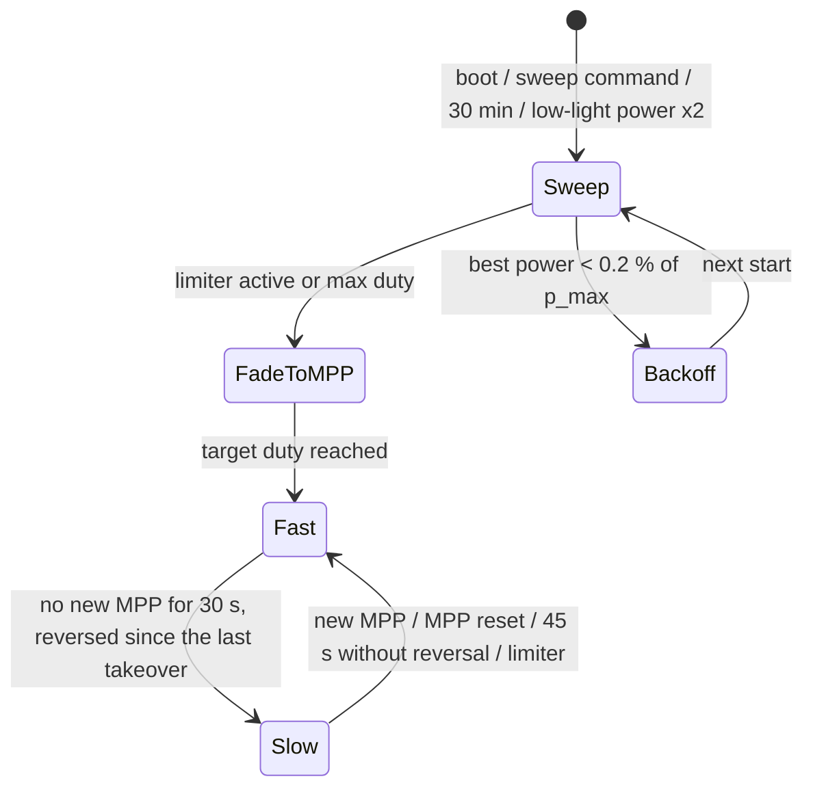

# MPP Tracker

The tracker finds and follows the maximum power point (MPP) of the solar input by moving the converter duty cycle.
It runs inside the [control loop](control-loop.md) only while no limiter is active.

## Phases

Tracking runs in three phases:

1. Global sweep: the duty cycle rises from 0 and the tracker captures the MPP. The sweep ends when a limiter
   becomes active (input undervoltage, output overvoltage, overcurrent, power limit) or the duty reaches its maximum.
2. Fast tracking: perturb & observe (P&O) around the captured MPP.
3. Slow tracking: P&O with a lower rate, smaller steps, and a smaller mean tracking error. A new power maximum,
   a major drop in power (clouds, partial shading), a limiter, or 45 s without a direction reversal switches
   back to fast tracking.

A new global sweep runs every 30 minutes so the tracker does not stay on a local maximum, which happens with
partially shaded strings. A sweep takes 20–60 s, depending on the loop rate. Sweeping too often or too slowly
costs yield.

In low light, power changes between P&O steps stay below the tracker's thresholds, so P&O cannot follow an
MPP that moves while the light changes (see [Perturb & observe](#perturb--observe)). If the last sweep
captured less than 5 % of `limits.conf::p_max`, the tracker therefore starts another sweep once power has
doubled since that sweep, at most every 2 minutes. At dawn this adds a few short sweeps while the power is
still low.

The following state diagram shows the transitions between the phases:

## Global sweep

A sweep (`startSweep()` in `src/mppt.h`) runs these steps:

1. It disables the converter, clears the fade target, and resets the PD controllers.
2. It starts a sensor calibration. The periodic re-sweep doubles as periodic calibration.
3. Once calibration is done, it raises the duty each tick. `sweep_speed` caps the step, and the distance to the
   nearest limit scales it, so the ramp slows down when approaching a V/I/P limit.
4. It records the sample with the highest smoothed power as the MPP. It ignores samples below 0.2 % of
   `limits.conf::p_max` (2 W at 1 kW, `sweepMinPower()`), so a sweep in marginal light cannot "peak" at a
   near-maximum-duty phantom point.

The sweep stops as soon as any limiter produces a control mode (CV, CC, or CP), including the bounce at the maximum
duty. The captured MPP duty becomes the target, and the loop fades to it with a bounded step before handing over to
P&O.

If the best captured power is below that floor, the sweep commits no target. The converter shuts down for 30 s and
resumes through the normal start path. The firmware logs this backoff at info level as
`backoff 30s [sweep-no-mpp]`, not as a fault. A source that cannot deliver that power, such as a current-limited
bench supply, repeats this cycle indefinitely.

At the end of a sweep, the firmware writes "MPP Scan done" to the LCD and logs
`Stop sweep ... MPP=(<W>,<duty>,<V>)`.

## Perturb & observe

`Tracker::update()` (`src/tracker.h`) averages power and Vin over one tracker period, then compares the period
mean with the last reference power. These rules set the direction:

- If the power change exceeds the absolute or relative threshold and is negative, the direction reverses.
- After a reversal, the tracker does not judge the power change during a settle window. The reference power
  follows the measurement instead. The filtered power still lags behind the old direction, and the input
  capacitor discharges while Vin falls and charges while it rises, so the output power dips right after a turn
  toward higher Vin. A decision in that window would reverse again, mostly toward lower Vin. A hand-back from a
  limiter to P&O starts the same window.
- If Vin moved by more than 5 % since the last reversal, the direction reverses as well. This handles cloud
  recovery, because tracking a light transient can drift far from the MPP. The 5 % refers to the higher of the
  two voltages, so a leg down and the following leg up have the same length.
- Below 1 W, the tracker always increases duty.

In low light the power change across one 5 % leg near the MPP is about 1 % of the power, below the
thresholds and close to the current-sensor noise. The tracker then oscillates within the 5 % band around
where it is. Both rules above keep that oscillation free of a bias toward the battery voltage: with a band
measured from each leg's start (5 % down, then 5 % of the lower voltage up), every cycle ended 0.25 % lower,
and the re-reversals after a turn walked Vin down in the same way.

### Settle window

The window lasts until both of these hold, but never longer than 1 s:

- The power filter has settled. Each power sensor (current and voltage) has a median of 5, which delays a
  step by 2 samples, and a 2-pass EWMA with span $N$, so each pass has a time constant of $\tau \approx N/2$
  samples. The EWMA step response reaches 99 % after $6.64\,\tau$. At the sensor's sample rate $f_s$, the
  settling time is $t_f = (3.32\,N + 2) / f_s$. The slower of the two sensors sets $t_f$. The sample rate is
  the one the sampler uses to tune the sensor's notch filter.
- Vin is back at the voltage of the reversal. In low light the input capacitor makes Vin lag the duty by
  about $C V / (2.5\, I)$, for example 0.34 s with 470 µF at 2 W and 60 V. Vin keeps moving in the old
  direction for a moment, then turns. When it gets back to the reversal voltage, the capacitor current has
  mostly reversed. This measures the plant lag directly, so the capacitance does not need to be configured.
  This condition applies in fast mode only. A slow-mode period (500 ms) already outlasts the lag, and the
  window can only end at a period boundary: when changing light keeps Vin from coming back, the wait would
  skip a whole period and double the leg.

| Power sensor profile                  | $f_s$  | $N$ | $t_f$   |
|---------------------------------------|--------|-----|---------|
| INA226, 1.1 ms conversion             | 450 Hz | 20  | 152 ms  |
| INA226 at its slowest rate            | 200 Hz | 20  | 342 ms  |
| INA226, filter length 60              | 450 Hz | 60  | 447 ms  |
| ADS1015, three muxed channels         | 120 Hz | 60  | 1 s (capped from 1.6 s) |

A limiter hand-back starts the window but does not count as a reversal. It is a takeover for the slow-mode
condition below: it ends slow mode, and the tracker continues in fast mode for at least 30 s after a derate,
a CV hold, or a sweep.

The 1 s cap bounds a leg that the tracker walks without judging power. In simulation, a 1.5 s window
harvested less than a fixed 150 ms window, because the excursion it allows costs more than the filter lag
does.

Slow mode evaluates every 500 ms, so the filter part of the window rarely covers an evaluation there. Skipping
the first slow-mode evaluation after each reversal made no measurable difference in simulation, so slow mode
uses the same rule. The Vin condition has no deadband: ending the window 0.1 % of Vin early lost about 1 % of
harvest at 2 to 20 W, and ending it 0.1 % late made no measurable difference.

The tracker keeps its own MPP record. It resets the record after 5 min, or when the current power is below 85 % of
the recorded MPP and the record is more than 30 s old (`Reset maxPower <record> (P=<power>)`). A period whose
power exceeds the record by 0.5 % replaces it, which includes the first period after a reset.

Fast and slow mode use these parameters:

| Parameter              | Fast mode | Slow mode |
|------------------------|-----------|-----------|
| Update rate            | 30 Hz     | 2 Hz      |
| Step (control value)   | 0.5       | 0.02      |
| Min. power step, abs.  | 1.0 W     | 0.5 W     |
| Min. power step, rel.  | 1.5 %     | 0.15 %    |

The mode is decided once per tracker period, after the MPP record is updated. The tracker enters slow mode when
all of these hold:

- Power is above 2 W (0.5 W to stay, hysteresis).
- No new MPP was recorded for 30 s.
- The last takeover is more than 30 s ago, and the direction reversed since then. A takeover is a limiter
  hand-back, which includes the end of the fade after a sweep and the start-up.
- The last reversal is less than 45 s ago.

Slow mode ends on a new MPP record (a 0.5 % gain, or the first period after a reset), on a takeover, and 45 s
after the last reversal. Moving one way for that long means the MPP has moved. A slow-mode pass across its power
band near the MPP takes about 35 s, so a limit of 15 s dropped back to fast mode every 20 to 60 s.

The MPP record reset is evaluated before the entry, so the tracker does not enter slow mode in the same period in
which the record is about to be reset. The 5-minute record reset also ends slow mode: the record is at least 30 s
old at entry, so a slow-mode episode lasts at most about 270 s.

On entry to slow mode the tracker returns the distance from the current duty to the duty of the recorded MPP
in place of a step. The control loop applies it like any control value, scaled with the slew rate and the
loop period and capped by the limiters, so the duty moves by a small fraction of that distance. The log shows
the duty before and after that tick (`Slow mode, duty <from> -> <to> (<step>, MPP duty <d>, P=<W>)`).

The console command `speed <x>` (0 ≤ x < 10) scales the tracker step (default 1.0).

## When the tracker does not sweep

The tracker skips the periodic re-sweep under these conditions:

| Condition                                             | Why                                                           |
|-------------------------------------------------------|---------------------------------------------------------------|
| PSU / PV-sim mode                                     | No MPP to track; the output is regulated to a setpoint        |
| A sweep is already running                            |                                                               |
| Charge hold (terminated, partial-charge ceiling, too cold) | Ramping duty from 0 would dump a charge pulse into a full pack |
| Control mode is CV (output-voltage limited)           | Same: the pack is full or the output is disconnected          |
| A protection backoff is pending                       | A sweep into an active trip timer would stall                 |

When a BMS cell-voltage topic is configured, the sweep at start-up and after a shutdown also waits for the BMS. It
is skipped while termination is active and the BMS data is fresh, and it waits up to 12 s for the first termination
decision. A fresh-to-stale BMS edge re-arms that wait at most once per 10 min, so a flapping BMS
cannot block the sweep indefinitely. See [Charge Termination](../guide/charging/termination.md).

`tracker.conf::target_duty_cycle > 0` skips the sweep entirely and holds a fixed duty (manual PWM).

## Configuration

The tracker reads these keys from `tracker.conf`:

| Key                                                                  | Default | Effect                                               |
|----------------------------------------------------------------------|---------|------------------------------------------------------|
| [`sweep_speed`](../reference/config/tracker.md)                      | 4.0     | Sweep speed; scales the per-tick cap and the limit-tracking gain (min 0.1) |
| [`target_duty_cycle`](../reference/config/tracker.md)                | 0.0     | Fixed duty fraction; > 0 disables sweep and P&O      |

Console: `sweep` starts a global sweep, `mppt` returns to automatic tracking, `speed <x>` scales the P&O step. See
[Console](../reference/console.md).
