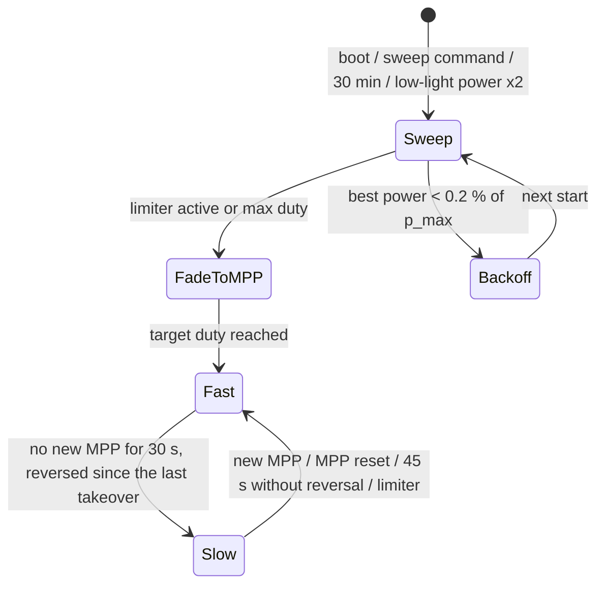

# MPP Tracker

The tracker finds and follows the maximum power point (MPP) of the solar input by moving the converter duty cycle.
It runs inside the [control loop](control-loop.md) only while no limiter is active.

## Phases

Tracking runs in three phases:

1. Global sweep: the duty cycle rises from 0 and the tracker captures the MPP. The sweep ends when a limiter
   becomes active (input undervoltage, output overvoltage, overcurrent, power limit) or the duty reaches its maximum.
2. Fast tracking: perturb & observe (P&O) around the captured MPP.
3. Slow tracking: P&O with a lower rate, smaller steps, and a smaller mean tracking error. A new power maximum,
   a major drop in power (clouds, partial shading), a limiter, or 45 s without a direction reversal switches
   back to fast tracking.

A new global sweep runs every 30 minutes so the tracker does not stay on a local maximum, which happens with
partially shaded strings. A sweep takes 20–60 s, depending on the loop rate. Sweeping too often or too slowly
costs yield. On a buck, once a sweep has shown a shaded string, a [partial peak scan](#partial-peak-scan) checks the
other local maxima in about 1–3 s, every 5 minutes and after a sustained change.

In low light, power changes between P&O steps stay below the tracker's thresholds, so P&O cannot follow an
MPP that moves while the light changes (see [Perturb & observe](#perturb--observe)). If the last sweep
captured less than 5 % of `limits.conf::p_max`, the tracker therefore starts another sweep once power has
doubled since that sweep, at most every 2 minutes. At dawn this adds a few short sweeps while the power is
still low.

The following state diagram shows the transitions between the phases:

## Global sweep

A sweep (`startSweep()` in `src/mppt.h`) runs these steps:

1. It disables the converter, clears the fade target, and resets the PD controllers.
2. It starts a sensor calibration. The periodic re-sweep doubles as periodic calibration.
3. Once calibration is done, it raises the duty each tick. `sweep_speed` caps the step, and the distance to the
   nearest limit scales it, so the ramp slows down when approaching a V/I/P limit.
4. It records the sample with the highest smoothed power as the MPP. It ignores samples below 0.2 % of
   `limits.conf::p_max` (2 W at 1 kW, `sweepMinPower()`), so a sweep in marginal light cannot "peak" at a
   near-maximum-duty phantom point.

The sweep stops as soon as any limiter produces a control mode (CV, CC, or CP), including the bounce at the maximum
duty. The captured MPP duty becomes the target, and the loop fades to it with a bounded step before handing over to
P&O.

If the best captured power is below that floor, the sweep commits no target. The converter shuts down for 30 s and
resumes through the normal start path. The firmware logs this backoff at info level as
`backoff 30s [sweep-no-mpp]`, not as a fault. A source that cannot deliver that power, such as a current-limited
bench supply, repeats this cycle indefinitely.

At the end of a sweep, the firmware writes "MPP Scan done" to the LCD and logs
`Stop sweep ... MPP=(<W>,<duty>,<V>)`.

## Perturb & observe

`Tracker::update()` (`src/tracker.h`) averages power and Vin over one tracker period, then compares the period
mean with the last reference power. These rules set the direction:

- If the power change exceeds the absolute or relative threshold and is negative, the direction reverses.
- After a reversal, the tracker does not judge the power change during a settle window. The reference power
  follows the measurement instead. The filtered power still lags behind the old direction, and the input
  capacitor discharges while Vin falls and charges while it rises, so the output power dips right after a turn
  toward higher Vin. A decision in that window would reverse again, mostly toward lower Vin. A hand-back from a
  limiter to P&O starts the same window.
- If Vin moved by more than 5 % since the last reversal, the direction reverses as well. This handles cloud
  recovery, because tracking a light transient can drift far from the MPP. The 5 % refers to the higher of the
  two voltages, so a leg down and the following leg up have the same length.
- Below 1 W, the tracker always increases duty.

In low light the power change across one 5 % leg near the MPP is about 1 % of the power, below the
thresholds and close to the current-sensor noise. The tracker then oscillates within the 5 % band around
where it is. Both rules above keep that oscillation free of a bias toward the battery voltage: with a band
measured from each leg's start (5 % down, then 5 % of the lower voltage up), every cycle ended 0.25 % lower,
and the re-reversals after a turn walked Vin down in the same way.

### Settle window

The window applies in fast mode and lasts until both of these hold, but never longer than 1 s:

- The power filter has settled. Each power sensor (current and voltage) has a median of 5, which delays a
  step by 2 samples, and a 2-pass EWMA with span $N$, so each pass has a time constant of $\tau \approx N/2$
  samples. The EWMA step response reaches 99 % after $6.64\,\tau$. At the sensor's sample rate $f_s$, the
  settling time is $t_f = (3.32\,N + 2) / f_s$. The slower of the two sensors sets $t_f$. The sample rate is
  the one the sampler uses to tune the sensor's notch filter.
- Vin is back at the voltage of the reversal. In low light the input capacitor makes Vin lag the duty by
  about $C V / (2.5\, I)$, for example 0.34 s with 470 µF at 2 W and 60 V. Vin keeps moving in the old
  direction for a moment, then turns. When it gets back to the reversal voltage, the capacitor current has
  mostly reversed. This measures the plant lag directly, so the capacitance does not need to be configured.

| Power sensor profile                  | $f_s$  | $N$ | $t_f$   |
|---------------------------------------|--------|-----|---------|
| INA226, 1.1 ms conversion             | 450 Hz | 20  | 152 ms  |
| INA226 at its slowest rate            | 200 Hz | 20  | 342 ms  |
| INA226, filter length 60              | 450 Hz | 60  | 447 ms  |
| ADS1015, three muxed channels         | 120 Hz | 60  | 1 s (capped from 1.6 s) |

A limiter hand-back starts the window but does not count as a reversal. It is a takeover for the slow-mode
condition below: it ends slow mode, and the tracker continues in fast mode for at least 30 s after a derate,
a CV hold, or a sweep.

The 1 s cap bounds a leg that the tracker walks without judging power. In simulation, a 1.5 s window
harvested less than a fixed 150 ms window, because the excursion it allows costs more than the filter lag
does.

Slow mode has no settle window. It evaluates every 500 ms, so a window there can only end at an evaluation, and
any window that covers one skips it: the leg runs a whole period longer, and twice as long in total. In
simulation that happened when changing light kept Vin from coming back to the reversal voltage, and with power
filters that settle in more than 500 ms (filter length 60 at a low sample rate). Under an irradiance wobble of
0.5 % at 0.2 Hz it cost 3 to 4 % of harvest without sensor noise and 0.2 to 1.7 % with measured sensor noise.
Without the window, the first slow evaluation compares against a reference that still carries the filter lag
and the input-capacitor current. That costs little because the slow-mode slew is 25 times slower than in fast
mode. The capacitor power $C V \, dV/dt$ scales with the slew. In slow mode it is a few mW (470 µF at 60 V), below
the slow-mode threshold of 0.15 % of $(P + 5\,\text{W})$, which is 10.5 mW at 2 W. The trade-off in simulation was at dusk: 0.1 to 0.5 % of
harvest on average, up to 0.8 % in a single run with a slow power filter, and up to 1.4 % for single noise
realisations. Without the window the tracker also reverses more often (with a slow filter, 21.5 to 28 reversals
per minute at dusk).

The Vin condition has no deadband: ending the window 0.1 % of Vin early lost about 1 % of
harvest at 2 to 20 W, and ending it 0.1 % late made no measurable difference.

The tracker keeps its own MPP record. It resets the record after 5 min, or when the current power is below 85 % of
the recorded MPP and the record is more than 30 s old (`Reset maxPower <record> (P=<power>)`). A period whose
power exceeds the record by 0.5 % replaces it, which includes the first period after a reset.

Fast and slow mode use these parameters:

| Parameter              | Fast mode | Slow mode |
|------------------------|-----------|-----------|
| Update rate            | 30 Hz     | 2 Hz      |
| Step (control value)   | 0.5       | 0.02      |
| Min. power step, abs.  | 1.0 W     | 0.5 W     |
| Min. power step, rel.  | 1.5 %     | 0.15 %    |

The mode is decided once per tracker period, after the MPP record is updated. The tracker enters slow mode when
all of these hold:

- Power is above 2 W (0.5 W to stay, hysteresis).
- No new MPP was recorded for 30 s.
- The last takeover is more than 30 s ago, and the direction reversed since then. A takeover is a limiter
  hand-back, which includes the end of the fade after a sweep and the start-up.
- The last reversal is less than 45 s ago.

Slow mode ends on a new MPP record (a 0.5 % gain, or the first period after a reset), on a takeover, and 45 s
after the last reversal. Moving one way for that long means the MPP has moved. A slow-mode pass across its power
band near the MPP takes about 35 s, so a limit of 15 s dropped back to fast mode every 20 to 60 s.

The MPP record reset is evaluated before the entry, so the tracker does not enter slow mode in the same period in
which the record is about to be reset. The 5-minute record reset also ends slow mode: the record is at least 30 s
old at entry, so a slow-mode episode lasts at most about 270 s.

On entry to slow mode the tracker returns the distance from the current duty to the duty of the recorded MPP
in place of a step. The control loop applies it like any control value, scaled with the slew rate and the
loop period and capped by the limiters, so the duty moves by a small fraction of that distance. The log shows
the duty before and after that tick (`Slow mode, duty <from> -> <to> (<step>, MPP duty <d>, P=<W>)`).

The console command `speed <x>` (0 ≤ x < 10) scales the tracker step (default 1.0).

### Steady-state efficiency and noise

A simplified model shows how measurement noise limits P&O in steady light. Near the MPP the power curve is
$P(x) = P_m(1 - c\,x^2)$ with $x = (V - V_m)/V_m$. The single-diode model gives $c \approx 1 + V_m/(2 n V_t)$
per cell, about 9 for crystalline silicon, independent of the number of cells in series. The model assumes a fixed
curve (constant irradiance and temperature) and independent noise in each period's power reading.

- Without noise, P&O with step $\delta = \Delta V / V_m$ oscillates around the MPP with efficiency
  $\eta = 1 - c\,\delta^2/2$. For steps of about one PWM count this loss is negligible.
- With noise larger than the per-step power change, and $\sigma$ the relative noise of each period-averaged power
  reading, the operating point performs a random walk with a drift toward the MPP. The stationary variance of $x$
  is $\sqrt{\pi}\,\sigma/(4c)$, so $\eta \approx 1 - \tfrac{\sqrt{\pi}}{4}\,\sigma \approx 1 - 0.44\,\sigma$.
  Step size and curvature cancel. The approximation ignores the direction persistence of P&O and holds to within
  about a factor of 2.
- With a relative decision threshold $\theta$, the point wanders within $P > P_m(1 - \theta)$ and
  $\eta \approx 1 - \theta/3$. Keeping false reversals rare needs $\theta \approx k\sqrt{2}\,\sigma$ with
  $k \approx 2\ldots3$, so $\eta \approx 1 - (0.9\ldots1.4)\,\sigma$. The threshold costs steady-state efficiency
  but protects against walk-off driven by noise and changing irradiance, which this model does not include.

Averaging sets $\sigma = \sigma_\text{raw}/\sqrt{N}$ with $N \approx f_s T_d$ (sample rate times decision period);
filters and correlated noise reduce the effective $N$. At low power $\sigma$ grows as $1/P$, so dawn, dusk and low
light dominate the steady-state loss. A longer decision period lowers $\sigma$ but follows changing irradiance more
slowly, which is a separate loss. With the relative thresholds above, $\theta/3$ is about 0.05 % in slow mode and
0.5 % in fast mode. The threshold is relative to $P + 5\,\text{W}$, and the absolute threshold applies when it is
smaller, so the effective $\theta$ is larger at low power and smaller at high power.

## Partial peak scan

A string of modules with bypass diodes has one local power maximum per number of conducting substrings. When
the $m$ strongest of $n$ substrings conduct at their own MPP and the others are bypassed, the maximum sits near
$m$ unshaded substring MPP voltages, lower by the forward drops of the conducting bypass diodes. A maximum at
which weaker substrings also conduct sits higher: the stronger substrings carry the current of the weakest
one, above their own MPP voltage. Two 60-cell modules in series have $n = 6$. P&O climbs the maximum it starts
on and stays there until the next global sweep, even when another maximum is higher.

`PeakScan` (`src/peak_scan.h`) probes one voltage per candidate maximum. It needs the number of substrings $n$,
which it learns from the global sweeps (below), and a buck converter (no-op on boost). It runs in tracking mode
only (no limiter, sweep, fade, charge hold, rect-cal run, manual, PSU or PV-sim mode), above 5 % of
`limits.conf::p_max`:

1. Candidates: the unshaded substring share is estimated as $s_0 = k\,V_{oc}/n$, with $V_{oc}$ the input
   voltage at the start of the last global sweep (converter off) and $k = V_{mpp}/V_{oc}$ taken from the sweep's
   maximum when it lies in 0.74..0.86 (an unshaded string); otherwise the last value is kept (0.82 at start). The operating point is assigned to the
   nearest multiple $m_0$ of $s_0$. $V_{in}/m_0$ overestimates the share when weaker substrings conduct at the
   operating point, $s_0$ misses heating since the sweep and the spread of $V_{mpp}/V_{oc}$; the scan uses their
   mean $s = (V_{in}/m_0 + s_0)/2$. Each candidate $m \neq m_0$ is placed at $0.97\,m\,s$. A candidate below
   1.05 times the input voltage floor (the input undervoltage limit, and on a buck the start ratio of the
   low-side minimum pulse, about $1.2\,V_{out}$), or above $0.95\,V_{oc}$, is skipped.
2. A lower candidate ($m < m_0$) delivers at most $m\,s$ times the largest current seen since the last sweep
   (the sweep passes every maximum). If that is below the present power plus the margin, the candidate is
   skipped. On an unshaded string in full sun this skips every candidate, and no scan runs.
3. The scan holds the operating point, waits for the power filter to settle (`powerSettleMs()`, at most 1 s),
   and averages the power for 100 ms ($P_0$). It then steers $V_{in}$ to each candidate in turn (duty
   $D\sqrt{V_{in}/V_c}$ each loop tick, at most the fade step), settles, and averages again. Finally it returns
   to the start point and measures $P_0'$. A scan that is not done after 30 s ends at the start point.
4. Each probe is compared with $\max(P_0, P_0')$, so a change of irradiance during the scan cannot make a probe
   look better. If $P_0'$ differs from $P_0$ by more than 15 %, the light changed too much and the scan keeps
   the start point. Otherwise the best probe wins if it beats the reference by 3 %; the converter moves there,
   and P&O restarts in fast mode towards higher $V_{in}$, with a new MPP record. If no probe wins, the tracker
   continues where it was, in the same mode.

The log shows each scan as `scan: P <P0>-><P0'> W at <V>V, <n> probes, best x<ratio> at <V>V[, moving]`.

### Substring count

The sweep runs from $V_{oc}$ down to the battery and passes every maximum. It records the local maxima of the
smoothed power below $0.93\,V_{oc}$ that have a dip of 8 % on both sides (up to 6; a sweep with more is noise and
does not count). Within 3 s after the sweep, the low-frequency loop (core 0) evaluates them:

* The sweep's MPP must be one of the recorded maxima, and at least 5 % of `limits.conf::p_max`.
* The first recorded maximum with at least 60 % of the MPP power is taken as the full-string maximum. Maxima above
  it are ignored; this is where the start transient of the converter near $V_{oc}$ shows up on some boards.
* The lower maxima are those below the full-string maximum with at least 30 % of the MPP power. Without one, the
  sweep teaches nothing.
* The count is the largest $n$ in 2..6 for which every lower maximum lies between $m - 0.25$ and $m + 0.5$ shares of
  $0.82\,V_{oc}/n$ for a whole $m < n$. The window is asymmetric because a shaded maximum sits above its $m$
  unshaded shares (see above). If no $n$ fits, the sweep teaches nothing.

One sweep is enough. The count only grows: a sweep that fits a smaller $n$ changes nothing. The log shows
`scan: <n> bypass-diode substrings learned from the sweep`. Until a count is learned the scan is off, so an
unshaded string never scans.

The count is kept in `tracker.conf::pv_substrings`. It is written once when it grows, as soon as a flash write is
safe (converter off, or below 5 W), and before a console restart. Setting it to 0 (`set-config`) makes the
converter learn it again after the next restart; until then the running count stays in use. A count learned
earlier in the same boot and not yet saved can still be written over the 0, so set it while the converter is off
and restart right after. It is not meant to be set by hand otherwise.

The evaluation works on a copy of the maxima. If a new sweep or a scan starts while it runs, the sweep is dropped.

A shadow that comes and goes between two sweeps (30 minutes apart) after the first boot is not scanned on that pass.

The grid of 6 shares also holds every multiple of 1/3, and lies within half a share of every multiple of 1/4 and
1/5. The count therefore says which probe grid to use, not how many substrings there are:

| Substrings | Learned | Effect on the scan |
|---|---|---|
| 6 | 6 | Probes at every maximum |
| 2 or 3 | 6 | Extra probes at sixths that hold no maximum |
| 4 | 5 (one substring shaded) or 6 (two) | Probes up to half a share off some maxima (1/4 and 3/4 with 6, 2/4 with 5) |
| 5 | 6 (one substring shaded) or 5 (two) | With 6, probes up to 0.4 of a sixth off the maxima |
| More than 6 | At most 6 | Probes off the maxima |

A probe off a maximum measures less power than the maximum gives, so a better maximum can be missed; an extra
probe costs a few hundred milliseconds. Neither causes a wrong move: the scan moves only to a probe that measured
more power than the operating point, and P&O then climbs from there.

Two unshaded cases can fake a count, both on the grid of 6:

* A cloud edge during a sweep fakes a lower maximum on the grid.
* A start transient between $0.9$ and $0.93\,V_{oc}$ with at least 60 % of the MPP power, followed by a hot-module
  MPP at or below $0.75\,V_{oc}$, looks like a shaded full string over its MPP. The transient is near-constant
  power (about 100 W on the boards measured), so this needs low light and hot modules together.

The scan then runs on an unshaded string, probes, and stays; on a string of 6 substrings the count is right anyway.

### Schedule and cost

A scan starts every `scan_interval` seconds (default 300) after the last scan or sweep, and 60 s after a scan
whose best probe came within 6 % of the reference: under clouds the ratio between two maxima changes, and a
probe taken in a cloud can miss a maximum that wins in the sun. With `scan_trigger=1` a scan also starts when,
for 15 s without interruption, $V_{in}$ is more than half a substring share away from the voltage after the
last scan, or the power is below 70 % or above 140 % of the power then. The power must also have stayed within
±10 % for the last 5 s, and the last scan must be at least 60 s ago. A passing cloud changes the power by more
than that every few seconds, so most cloud edges do not trigger a scan; a shadow that moves across the string
over minutes does.

A limiter that becomes active during a scan ends it, and the duty fades back to the start point. A change of
operating mode (manual, PSU, PV-sim, MPPT) drops a running scan and its reference; PSU and PV-sim mode keep
their own regulation.

A scan takes 1.5 to 4 s and costs 10 to 150 J at 200 to 450 W, depending on the number of probes: the power
given up at the probes plus the travel between them. A scan that moves to a better maximum pays this back
within seconds. A probe sits on the flat side of its maximum, so a maximum less than about 5 % above the
operating point is often not taken.

## When the tracker does not sweep

The tracker skips the periodic re-sweep under these conditions:

| Condition                                             | Why                                                           |
|-------------------------------------------------------|---------------------------------------------------------------|
| PSU / PV-sim mode                                     | No MPP to track; the output is regulated to a setpoint        |
| A sweep is already running                            |                                                               |
| Charge hold (terminated, partial-charge ceiling, too cold) | Ramping duty from 0 would dump a charge pulse into a full pack |
| Control mode is CV (output-voltage limited)           | Same: the pack is full or the output is disconnected          |
| A protection backoff is pending                       | A sweep into an active trip timer would stall                 |

When a BMS cell-voltage topic is configured, the sweep at start-up and after a shutdown also waits for the BMS. It
is skipped while termination is active and the BMS data is fresh, and it waits up to 12 s for the first termination
decision. A fresh-to-stale BMS edge re-arms that wait at most once per 10 min, so a flapping BMS
cannot block the sweep indefinitely. See [Charge Termination](../guide/charging/termination.md).

`tracker.conf::target_duty_cycle > 0` skips the sweep entirely and holds a fixed duty (manual PWM).

## Configuration

The tracker reads these keys from `tracker.conf`:

| Key                                                                  | Default | Effect                                               |
|----------------------------------------------------------------------|---------|------------------------------------------------------|
| [`sweep_speed`](../reference/config/tracker.md)                      | 4.0     | Sweep speed; scales the per-tick cap and the limit-tracking gain (min 0.1) |
| [`target_duty_cycle`](../reference/config/tracker.md)                | 0.0     | Fixed duty fraction; > 0 disables sweep and P&O      |
| [`scan_interval`](../reference/config/tracker.md)                    | 300     | Partial peak scan period [s]; 0 = triggered only     |
| [`scan_trigger`](../reference/config/tracker.md)                     | 1       | Also scan after a sustained Vin or power change      |

Console: `sweep` starts a global sweep, `mppt` returns to automatic tracking, `speed <x>` scales the P&O step. See
[Console](../reference/console.md).
