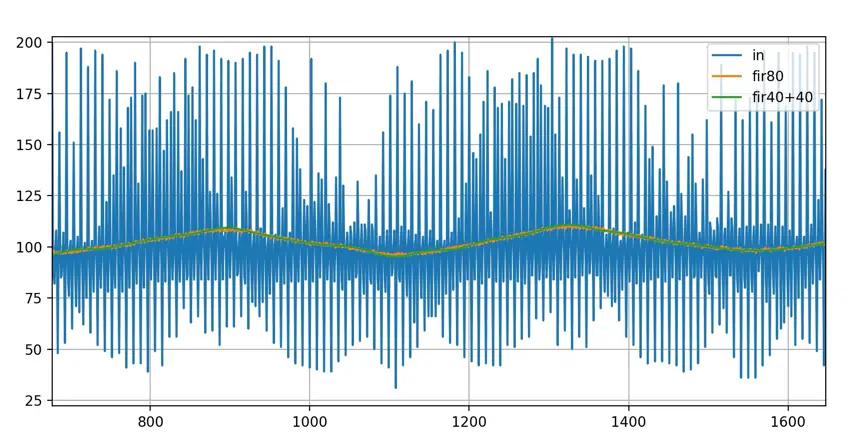
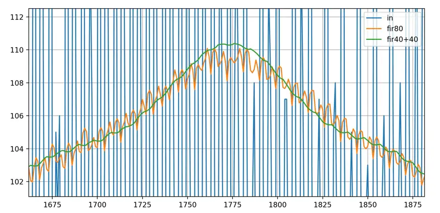
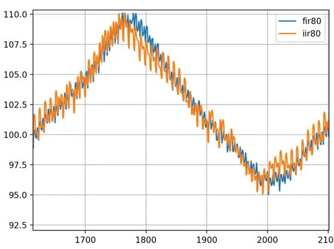
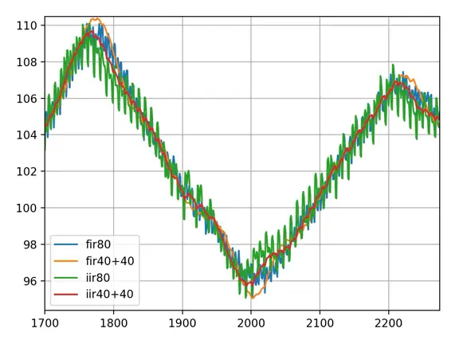

# Signal Filters

*Original hand-written notes: [doc/Signal Filters.md](https://github.com/fl4p/fugu-mppt-firmware/blob/main/doc/Signal%20Filters.md) and the README section [Signal Filtering](https://github.com/fl4p/fugu-mppt-firmware#signal-filtering).*

## Filter chain

Each new sample of a physical sensor, after scaling and offset calibration, passes through:

```
sample → notch → 5-sample running median → 2-pass EWMA
```

1. [Inverter-ripple notch](#inverter-ripple-notch), only on channels fast enough for it.
2. [Median filter](#median-filter) over the last 5 samples.
3. [2-pass EWMA](#ewma), an exponential moving average applied twice.

Different consumers read different stages:

| consumer                                         | value read                                                        |
|--------------------------------------------------|-------------------------------------------------------------------|
| Hard protection: Vin OV, Vout OV, Iin OC         | latest sample, before the notch                                   |
| Hard protection: Iout OC                         | trips on any of: sample > 1.5×, median > 1.25×, EWMA > 1.15× the limit |
| Vin limiter                                      | median                                                            |
| Vout, Iin and Iout limiters                      | median; EWMA while sweeping                                       |
| Power limiter, MPPT tracker power                | EWMA voltage × EWMA current of the side with a physical current sensor (output by default) |

## Noise sources

Noise can degrade tracking performance significantly.

The ADC itself is the most obvious noise source. You can easily reduce this noise by increasing the ADC conversion time
and sample averaging.

The loads connected to the battery are another significant noise source. The higher the impedance of the battery and
wiring, the greater the noise. To reduce noise coupling from the loads to the charger, connect the MPPT charger and the
loads separately, as close as possible to the battery terminals. Keep in mind that high-frequency noise can propagate
more easily due to wire inductance, even with very thick cables.

Laptops can have complex noise spectra that are difficult to describe. A sliding median filter and an averaging filter
work well here.

A 50 Hz inverter puts a 100 Hz ac component on the input, because the input sees `abs(sin(a*t))`. A notch filter can
remove this quite well. The [inverter-ripple notch](#inverter-ripple-notch) section describes the firmware's notch.

See also: [Krampmeier/uncertainty](https://github.com/Krampmeier/uncertainty).

## Median filter

A median filter removes spikes. It can filter load bursts.

The firmware uses a running median over 5 samples. By default every sample is replaced by that median.

### Despike

With `sensor.conf::despike` set to a value k > 0 (about 8; lower clips more), the median becomes decision-based. A
sample passes through unchanged unless both hold:

- it deviates from the median by more than k × the running mean deviation, and
- it deviates by more than 4 quantisation steps (learned per sensor).

Only such a sample is replaced by the median. Dense, recurring load pulses (for example from an inverter) then reach the
EWMA, so the average current is not biased low, while isolated glitches are still clipped.

- Default: `despike=0` (off, plain median).
- The NTC channel always uses the plain median.
- A warning is logged when clips exceed 0.5 % of the samples in a window.
- The median stage itself is unchanged; despike only changes what feeds the EWMA.

See [`sensor.conf`](../reference/config/sensor.md).

## Residual noise

IIR filters have a lower memory footprint and run faster than FIR filters. Their disadvantage is a nonlinear phase
response. The firmware measures only the dc amplitude and doesn't use phase information, so IIR filters are a good
choice. For background, see [FIR and IIR filters (NI DIAdem)](https://www.ni.com/docs/de-DE/bundle/diadem/page/genmaths/genmaths/calc_filterfir_iir.htm).

The following techniques address residual noise:

* use IIR filters
* use multipass filters
* adapt the window length to a given target noise

The firmware implements the first two as a 2-pass EWMA with a fixed span (see [EWMA](#ewma)). Adapting the window
length to a target noise is a possible improvement and is not implemented.

The following plots show the charger output current, sampled by the INA226 ADC. In this example measurement the INA226
was set to t_conv=1140µs, avg=1. The charger was connected to an LFP battery and a cheap Chinese inverter that produces
heavy burst noise. The sinusoidal inverter input adds a slight 100 Hz ac component, double the frequency of the 50Hz
220V output. The useful signal has a triangular waveform, which comes from the MPPT perturbation.

The first plot shows the noisy signal (blue), a moving average with N=80 (orange), and a 2-pass moving average with N=40:



The 2-pass filter has much better noise rejection:



The next plot shows a single IIR filter:



The last plot shows a 2-pass IIR filter:



Of these, the firmware uses the 2-pass IIR filter.

### EWMA

The averaging stage is an exponentially weighted moving average applied twice in series (2-pass), with
alpha = 2 / (span + 1).

- The span is the per-channel key `<side>_filt_len` in `sensor.conf` (for example `lv_i_filt_len`), default 10 samples.
- The NTC channel ignores `ntc_filt_len` and uses a fixed span of 50.

An adaptive noise estimator exists only as a diagnostic (console `anf on`); it does not change the filter.

## Inverter-ripple notch

An inverter on the DC bus draws ripple at twice the mains frequency (100 Hz for 50 Hz, 120 Hz for 60 Hz), which
corrupts the MPPT power estimate. Each physical sensor whose own sample rate allows it (f0 < 0.45·fs) gets an IIR
notch (biquad) at that frequency. Slower channels get none, and the notch settings have no effect on them.
The notch is 15 dB deep at its centre (`notch_depth`). With Q 20 it is narrow: at 100 Hz it attenuates 6 dB at
1 Hz off and 2.5 dB at 2 Hz off (at 450 sps, nearly independent of the depth), and it passes the ripple's
harmonics.

- Gain at the notch frequency: `notch_depth`, default −15 dB.
- Quality factor: `notch_q`, default 20 (bandwidth ≈ f0/Q).
- On a multiplexed ADC, `Vout` is sampled between every other channel, so it runs at a higher rate than the rest. Each
  notch is tuned to its sensor's actual rate.

By default, the notch tunes itself (`sensor.conf::notch_adaptive=1`):

- A ripple detector watches `Vout` before its notch, removes DC with a high-pass, and scans 80–140 Hz over blocks of
  about 0.75 s (fs·0.75, clamped to 128–1500 samples).
- An estimate is used only if its peak-to-mean ratio (SNR) is at least 15.
- The notch moves halfway toward each accepted estimate, and only when that step exceeds 0.3 Hz, which limits how far
  one noisy block can pull it.
- Detection and retuning run on the RT core, so filter coefficients never change under a running filter.
- Retuning updates one sensor per sample and waits while a flash write or erase is in progress.

With `notch_adaptive=0`, the notch stays at `notch_freq` (default 100 Hz). `notch_q` sets the bandwidth. See
[`sensor.conf`](../reference/config/sensor.md).

Background: [notch filters (video)](https://www.youtube.com/watch?v=tpAA5eUb6eo).

## Ripple comb

`sensor.conf::ripple_filter=comb` replaces the notch with a moving average over exactly one ripple period,
L = fs/f samples, where L is usually fractional (4.5 samples for 100 Hz at 450 sps). The filter integrates the
linearly interpolated input over the last L samples. With N = floor(L) and a = L − N, the taps from the newest sample
back are 1/2, 1, …, 1, 1/2 + a − a²/2 and a²/2, all divided by L. The taps sum to L, so the DC gain is exactly 1.

Properties:

- Rejection at the ripple frequency and its harmonics below fs/2 is deep but finite (exact zeros only for an integer
  L); see the table below. A harmonic that aliases (3f at 450 sps lands at 150 Hz) is attenuated less.
- The delay at DC and low frequencies is L/2 samples, half a ripple period (5 ms at 100 Hz). With a fractional L the
  taps are not symmetric, so the delay rises somewhat towards the ripple frequency.
- A step completes after ceil(L) samples, up to one sample longer than a period. The tracker's settling and sweep
  delay estimates include the comb.
- It runs in O(1) per sample: a running sum, re-summed once per buffer turn to bound rounding drift.
- Every sample enters a 24-sample ring, which keeps its history over a retune. A frequency change or a change of N
  causes no reset transient, but the output can still step because the window weights change.

The comb delays everything read from the median or EWM. These protections read raw samples and are not delayed:
the Vout over-voltage trip, the 1.5× Iout trip, the instantaneous reverse-current check (two raw samples) and the
Vout > 2·Vin trip. These read filtered values, so the comb's delay and its spreading of current spikes apply to them:
the lower Iout trips (median above 1.25×, EWM above 1.15× the limit), the reverse average-current trip, the
Vout > 1.25·Vin check and the short-circuit check.

The comb follows the same frequency as the notch (`notch_adaptive`, `notch_freq`). A channel whose period does not fit
the ring keeps the notch. The comb needs 2 ≤ L < 23 samples; with adaptive tuning over 80–140 Hz that is
280 sps ≤ fs < 1840 sps. `ripple_filter=both` runs the notch and then the comb.

Attenuation of the comb (adaptive tuning on the ripple), next to the notch:

| fs [sps] | ripple | at f | ±1 Hz | ±2 Hz | ±5 Hz | 2f | 3f |
|---|---|---|---|---|---|---|---|
| 450 | 100 Hz | −46 dB | −40 dB | −35 dB | −27 dB | −28 dB | −17 dB |
| 513 | 100 Hz | −52 dB | −39 dB | −34 dB | −27 dB | −39 dB | −29 dB |
| 1470 | 100 Hz | −78 dB | −40 dB | −34 dB | −26 dB | −66 dB | −58 dB |
| notch, 450 sps | 100 Hz | −15 dB | −6 dB | −2.5 dB | −0.5 dB | 0 dB | 0 dB |

A comb ahead of the median also keeps the mean of a pulsed current: the median of an unfiltered pulse train or of
leftover harmonics reads low.

### Choosing the filter

In the closed-loop host simulator with captured inverter noise and bus ripple, the two filters compare as follows:

- With the battery at the output-voltage cap, the Vout limiter reads the filtered voltage. Ripple harmonics from an
  inverter that draws current pulses pass the notch, and the limiter then throttles the converter. In those runs the
  notch kept 35–80 % of the available energy, the comb 85–96 %. With a pure-sine inverter both were equal.
- A deeper notch made this worse. With a strong second harmonic near half the sample rate, the leftover
  fundamental of a 15 dB notch keeps the median from passing the harmonic. At 30 dB the median output had more
  ripple, the limiter cut the duty harder, and one run kept 9 % instead of 80 %.
- With the ripple 1–3 Hz away from a fixed notch, the notch lost 8–17 % of the energy, the comb under 0.5 %. A
  60 Hz inverter (120 Hz ripple) with the filter fixed at 100 Hz cost the notch 84 % at the cap, the comb 2 %.
- Without an output cap and with a spiky current, the comb lost 1–7 % against the notch. The median can no longer
  remove a current spike once the comb has spread it over one period.
- Without ripple, the comb cost up to 0.6 % in some cloud, dusk and shade runs, and at dawn it sometimes added one
  no-MPP backoff.

The default is therefore `notch`. Use `comb` where an inverter with a pulsed input current shares the battery, or
where the ripple frequency is not well known.
